# NEXUS: Navigating Emergent X-agent Universe Simulator with Unprecedented Insight

> 🚀 From Information Streams to Simulatable Futures！

<div style="border-left: 4px solid #4CAF50; padding-left: 15px; background-color: #f7fcf7; padding: 10px; border-radius: 5px;">
    <p style="margin: 0; font-size: 1.05em; color: #333;">
        📞 Contact us here and welcome your coming !
    </p>
</div>

<ul style="list-style-type: none; padding-left: 0; margin-top: 15px;">
    <li style="margin-bottom: 10px; display: flex; align-items: center; gap: 10px;">
        <span style="color: #4CAF50; font-size: 1.2em;">👤</span> 
        <strong>Name: Minghao Li (Aiur), Yirui Liang (Loey), Qianqi Chen (Kiki) </strong>
    </li>
    <li style="margin-bottom: 10px; display: flex; align-items: center; gap: 10px;">
        <span style="color: #4CAF50; font-size: 1.2em;">🏫</span> 
        <strong>Affiliation:</strong> Beijing Normal - Hong Kong Baptist University (BNBU)
    </li>
    <li style="margin-bottom: 10px; display: flex; align-items: center; gap: 10px;">
        <span style="color: #4CAF50; font-size: 1.2em;">📧</span> 
        <strong>Email:</strong> <code>t330034027@mail.uic.edu.cn, laybaeknim@gmail.com, t3300340017@mail.uic.edu.cn</code>
    </li>
</ul>


<div align="left">
  <a href="https://suleynanauir.github.io/NEXUS-Navigating-Emergent-X-agent-Universe-Simulator-with-Unprecedented-Insight/">
    
  </a>
  <a href="survey/NEXUS_report.pdf">
  
  </a>
  <a href="assets/demo/demo.pdf">
    
  </a>
  
  
</div>

<p align="center">
  NEXUS says NO to formulaic writing and repetitive content 🙅, 
  delivering authentic, relevant information tailored to your actual needs ✅. 
  By integrating dynamic real-world factors and exploring diverse perspectives, 
  NEXUS breaks conventional thinking and inspires innovative ideas 💥. 
  Powered by a high-speed analysis engine with a 60% improvement in efficiency, 
  NEXUS enables you to uncover deep insights that would otherwise require days 
  of data collection — in just 30 minutes, at a cost of only ¥2 🔍.
</p>

<p align="center">
  <span style="font-size:20px; color:#e63946;">🌙✨</span>
  <span style="font-size:20px; color:#f77f00; font-weight:bold;">Anticipate the Unseen.</span><br>
  <span style="font-size:20px; color:#2a9d8f; font-weight:bold;">Understand the Emerging. 🌌</span>
</p>


<p align="center">
  
</p>
<p align="center">
  <span style="display:inline-block; background:#f8fafc; padding:1rem 2.2rem; border-radius:60px; font-size:1.2rem; color:#1e293b; border:1px solid #e2e8f0; box-shadow:0 4px 10px rgba(0,0,0,0.03);">
    <b>NEXUS Framework:</b> Domain-Specific Fine-Tuning × Deep Search × User Attention-Driven Reasoning × Digital Cognitive Twin — A Collaborative Multi-Agent Framework that Breaks Conventional Thinking and Redefines Intelligent Content Generation.
  </span>
</p>


<div align="center">
  <!-- 
    图片清晰度提示：
    - 为保证清晰，请使用宽度至少 1800px 的高分辨率图片（适配 2 倍屏）。
    - 此处设置 width="900"（固定像素），同时用 max-width:100% 保证移动端不溢出。
    - 如果原始图片宽度不足 900px，显示会模糊，请务必使用足够大的图片。
  -->
  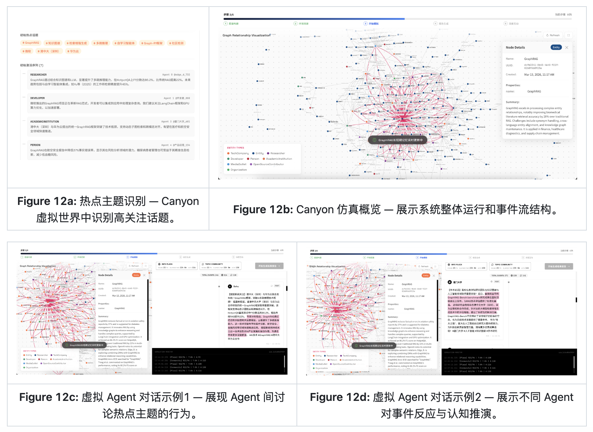
  <br><br>
  <a href="#step-1-information-prior-construction"
     style="display:inline-block;
            background:linear-gradient(135deg, #ff7a18, #ffb347, #ffa751);
            background-size:200% 200%;
            color:white;
            font-family:'Segoe UI', Roboto, system-ui, sans-serif;
            font-weight:600;
            font-size:1.2rem;
            letter-spacing:0.02em;
            padding:1rem 2.8rem;
            border-radius:60px;
            text-decoration:none;
            border:none;
            box-shadow:0 15px 25px -8px rgba(255,122,24,0.4),
                       0 4px 8px rgba(0,0,0,0.1),
                       inset 0 1px 2px rgba(255,255,255,0.6);
            cursor:pointer;
            transition:all 0.3s cubic-bezier(0.2,0.9,0.4,1);
            background-position:0% 0%;">
    🔍 View Highlight Detail
  </a>
</div>


<!-- 三张图片等宽度纵向排布 -->
<!-- 使用仿照示例的居中容器与图片样式，确保清晰度与视觉一致性 -->

<p align="center">
  <!-- 图片1：分组雷达图（学术风格） -->
  <!-- 固定宽度 1000 确保清晰，同时添加圆角与阴影，max-width 适配移动端 -->
  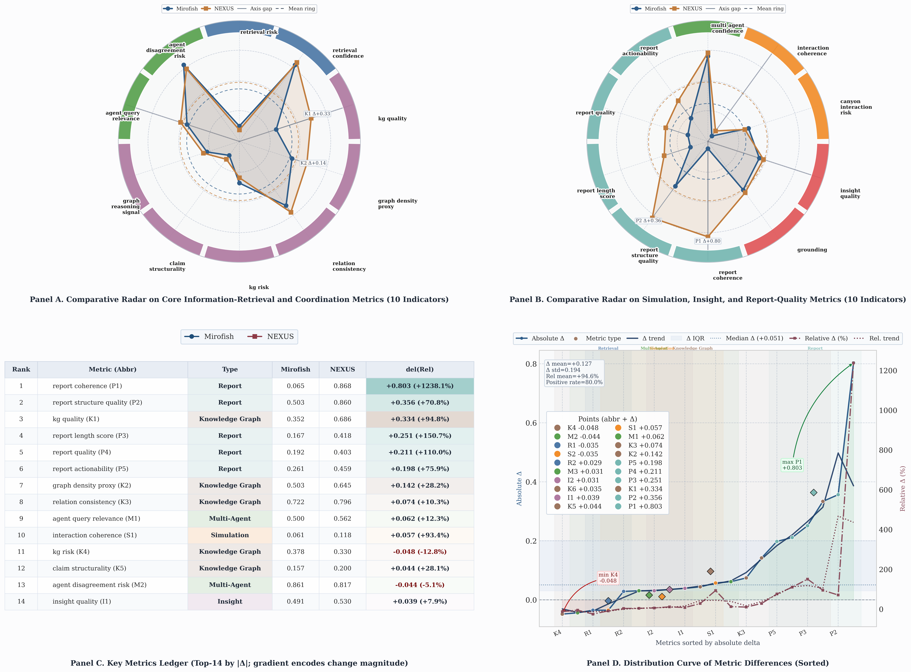
</p>

<p align="center">
  <!-- 图片2：稳定性相关图表 -->
  
</p>

<p align="center">
  <!-- 图片3：分布相关图表 -->
  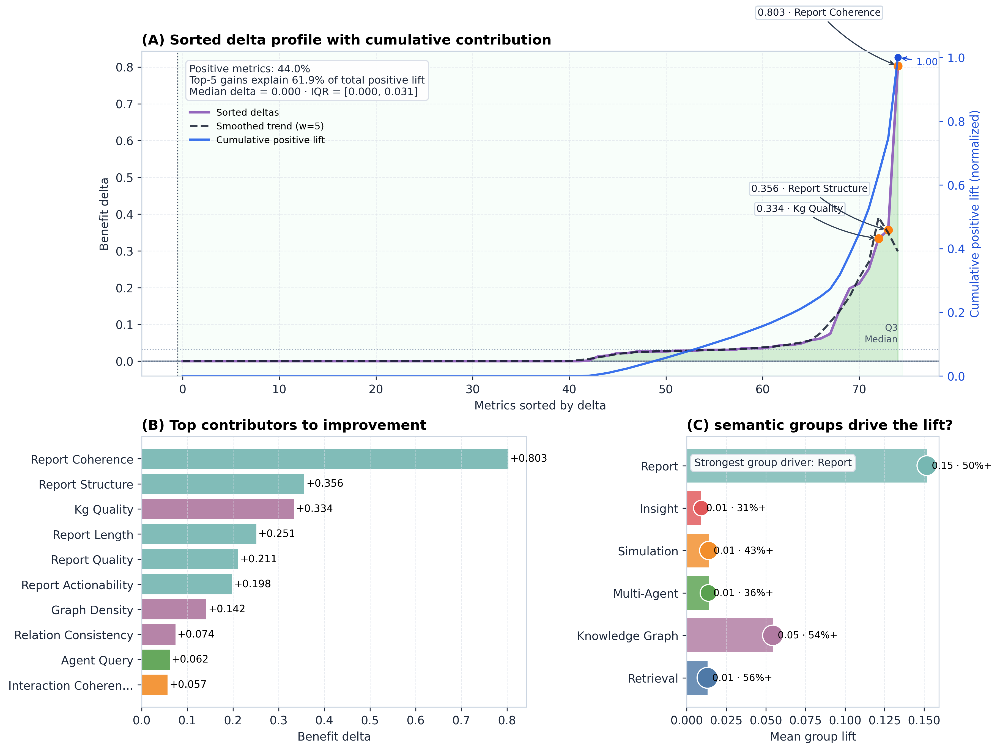
</p>


## 📊 1. Preview

> NEXUS bridges the gap between **Information Analysis** and **Social System Simulation** by integrating authentic, verified real-world information streams.

### 🌟 Key Features of NEXUS

- 🚀 **Beyond Generic Content — Personalized Cognitive Insights** 🔥🔥🔥

    Achieving cognitive breakthroughs based on users' genuine interests and information needs.

    - Conduct deep searches focused on <u>what users genuinely care about</u>, rather than <del>generic and superficial information</del>. 🙅
    - Construct a <u>personalized Cognitive Map</u> for each user, rather than relying on <del>one-size-fits-all analysis</del>.
    - 📖 **Related Literature:**
        - Farshidi et al. (2024), *Understanding User Intent Modeling for Conversational Recommender Systems*, [🔗 Springer Nature](https://link.springer.com/article/10.1007/s11257-024-09398-x)
        - Nguyen et al. (2018), *A Capsule Network-based Embedding Model for Search Personalization*, [🔗 arXiv](https://arxiv.org/abs/1804.04266)

- 🔗 **Beyond Redundant Data — High-Quality Information Integration** 🔥🔥

    Combining highly relevant deep search results with reliable information sources.

    - Integrate <u>domain-specific fine-tuned models</u>, rather than relying solely on <del>general-purpose LLMs</del>. 🙅
    - Implement a **User Attention Anchor-Driven Information Understanding Mechanism**, rather than <del>indiscriminate information processing</del>.

- 📈 **Beyond Prediction — Dynamic Simulation of Emerging Trends**

    - Incorporate **authentic, real-time, and dynamically evolving real-world factors** 🔥🔥, rather than <del>static or idealized assumptions</del>. 🙅
    - Construct a <u>high-fidelity Digital Cognitive Twin</u>, rather than <del>virtual environments based on idealized assumptions</del>. 🙅
    - 📖 **Related Literature:**
        - Guo et al. (2025), *Beyond Static Retrieval: Opportunities and Pitfalls of Iterative Retrieval in GraphRAG*, [🔗 arXiv](https://arxiv.org/abs/2509.25530)
        - Zhu et al. (2025), *Conversational Intent-Driven GraphRAG*, [🔗 arXiv](https://arxiv.org/abs/2506.19385)

- 💡 **Beyond Conventional Knowledge — Innovative and In-Depth Insights**

    Encouraging cognitive breakthroughs through diverse perspectives and out-of-the-box reasoning.

    - Generate **novel and thought-provoking ideas** 🔥🔥, rather than <del>rigid analysis or repetitive conventional wisdom</del>. 🙅
    - Generate **realistic simulated internal monologues and cognitive narratives** 🔥, rather than <del>superficial interpretations of individual behavior</del>. 🙅
    - 📖 **Related Literature:**
        - Zhong et al. (2023), *Beyond Sentiment: Cognitive and Narrative Open-Ended Generation*, [🔗 arXiv](https://arxiv.org/html/2502.13925v1)
        - Saunders (2012), *Towards Autonomous Creative Systems: A Computational Approach*, *Cognitive Computation*, 4(3), 216–225. [🔗 Article](https://www.robsaunders.net/publication/towards-autonomous-creative-systems-a-computational-approach/)

- 🌐 **Beyond a Single Perspective — Multi-Perspective Future Simulation** 🔥🔥🔥

    NEXUS supports the simulation of complex information environments from multiple stakeholder perspectives:

    - ⚖️ **Governments and Policymakers:** policymakers, regulatory authorities, and policy think tanks.
    - 💰 **Enterprises and Market Participants:** investment institutions, corporations, business intelligence organizations, venture capital (VC), and private equity (PE) firms.
    - 🧑‍🤝‍🧑 **Public Opinion and Social Communities:** social media users, key opinion leaders (KOLs), the general public, NGOs, and opinion amplifiers.
    - 🧑‍🔬 **Researchers and Expert Networks:** academic researchers, industry experts, and independent researchers.

- ⚡ **Beyond Simulation Volume — Greater Diversity, Higher Efficiency, and Deeper Insights** 🔥🔥🔥

    > This optimization enables high-frequency simulation while facilitating rapid insight generation and timely decision-making under limited computational and financial resources.

    - Compared with the original **MiroFish architecture**, NEXUS achieves substantial efficiency improvements, reducing simulation costs by up to **60%** and simulation time to approximately one-third of the original duration.
    - By integrating **Background Knowledge Priors** with **User Attention Anchors**, together with optimized agent persona configurations, NEXUS substantially reduces token consumption while maintaining analytical depth.
    - **Optimized Inference Configuration:** A tailored optimization strategy for OpenAI GPT-4o reduces computational overhead, lowering the cost per simulation from **$5 to $2–3**, representing a **40–60% cost reduction**.
    - **Accelerated Deep Analysis:** NEXUS requires only **30 simulation rounds** to generate high-quality insights, compared with **96 rounds** in the original MiroFish framework. The total analysis time is reduced from **50 minutes to 18–20 minutes**, representing a **60–64% reduction in processing time**.

---

### 🧠 From Information Streams to Cognitive Simulation

`NEXUS` is a **Multi-Agent Cognitive Simulation Framework** designed for the analysis and simulation of complex real-world information environments.

Guided by `User Preference Anchors`, NEXUS proactively discovers in-depth insights and strategic solutions aligned with users' cognitive objectives.

The framework systematically integrates highly relevant and reliable multi-source information, including **social media discourse, public opinion, policy developments, and financial intelligence**, establishing an end-to-end pipeline for intelligent information analysis and scenario simulation.

Through real-world information collection, semantic understanding, and relational reasoning, NEXUS reconstructs the underlying relationships and potential causal pathways between key events within a high-dimensional knowledge space.

By combining `Dynamic Simulation`, `Trend Projection`, and `Multi-Perspective Reasoning`, NEXUS aims to deliver deeper insights, explore emerging possibilities, and facilitate cognitive breakthroughs beyond conventional thinking.


## 🌐 2. What Can NEXUS Do?

### 🎭 Multi-Role Cognitive Simulation: Explore the World from Different Perspectives with NEXUS

NEXUS supports `multi-domain, multi-role, multi-perspective, and high-fidelity` simulation of complex information systems and future scenarios, enabling users to explore the following application scenarios:

#### 1️⃣ Decision Simulation Engine for Policymakers ⚖️

<p align="left">
  <a href="#step-4-multi-round-simulation-and-event-evolution-analysis">
    
  </a>
</p>

- 🔮 **Policy Ripple Effect Simulation:** Dynamically simulate the potential economic, public opinion, and public safety consequences following policy implementation.
- ⚠️ **Early Risk Identification:** Identify potential social conflicts and public opinion crises, and generate possible intervention strategies.
- 📊 **Retrospective Policy Evaluation:** Analyze the potential effects and underlying causal relationships of policy adjustments to support evidence-informed decision-making.

#### 2️⃣ Business Simulation Lab for Enterprises and Market Decision-Makers 💰

<p align="left">
  <a href="#step-4-multi-round-simulation-and-event-evolution-analysis">
    
  </a>
</p>

- 🔮 **Emerging Trend Forecasting:** Integrate multi-source information and User Preference Anchors to *dynamically explore emerging industry trends and evolving consumer perceptions*.
- ⚔️ **Competitive Intelligence:** Simulate competitor actions and market responses to *evaluate the potential impact of product launches, pricing strategies, and marketing campaigns*.
- 🧪 **Strategic Scenario Evaluation:** Conduct market simulations across multiple scenarios to <u>explore trade-offs among profitability, market share, and brand reputation</u>.

#### 3️⃣ Public Opinion Intelligence for Individuals and Social Communities 🧑‍🤝‍🧑

<p align="left">
  <a href="#step-4-multi-round-simulation-and-event-evolution-analysis">
    
  </a>
</p>

- 📊 **Public Sentiment Analysis:** Track emerging social media discussions and <u>the dynamic evolution of public sentiment</u> in real time.
- 🎯 **Key Opinion Leader Identification:** Identify Key Opinion Leaders (KOLs) and <u>estimate their relative influence on public discourse and event development</u>.
- ⚡ **Public Opinion Crisis Early Warning:** Identify potentially escalating events and <u>simulate information diffusion patterns, propagation scale, and associated risk levels</u>.

#### 4️⃣ Knowledge Intelligence Network for Researchers and Experts 🧑‍🔬

<p align="left">
  <a href="#step-4-multi-round-simulation-and-event-evolution-analysis">
    
  </a>
</p>

- 🧠 **Knowledge Graph Construction:** Integrate academic publications, policy reports, and emerging technological developments into <u>a dynamic, searchable knowledge network that supports relational reasoning</u>.
- 🔮 **Emerging Research Trend Identification:** Leverage historical data and real-time information streams to <u>identify emerging technologies, market opportunities, and evolving research topics</u>.


<div align="center" style="margin:40px 0;">
  <!-- Highlight Image -->
  
  <br><br>
  <!-- Navigation Button -->
  <a href="#step-1-information-prior-construction">
    <button style="
      background:linear-gradient(90deg,#ff7a18,#ffb347);
      color:white;
      border:none;
      padding:12px 22px;
      font-size:15px;
      font-weight:600;
      border-radius:10px;
      cursor:pointer;
      box-shadow:0 6px 16px rgba(0,0,0,0.18);
      transition:all 0.25s ease;
    ">
      🔍 Explore NEXUS Highlights
    </button>
  </a>
</div>


## 🧩 3. Core Architecture

NEXUS establishes a cognitive simulation system through the following core mechanisms:

<p align="center">
  
</p>

### 🚀 3.1 Core Workflow: From Real-World Information Streams to Future Scenario Simulation

> 💡 **Beyond Prediction — Simulating Possible Futures for Proactive Insights and Informed Decision-Making.**

- 🎯 **Step 1: Domain-Specific Fine-Tuning**  
**Focus on User Attention Anchors to enhance domain-specific understanding.**  
`#Targeted Fine-Tuning` `#Private Deployment` `#Attention Anchors`

    Leverage [LLaMa Foundary Pro](https://github.com/SuleynanAuir/Enterprise-Enhanced-LLaMA-Factory-Pro-Advanced-FineTuning-Local-Deployment-Pipeline), an integrated pipeline combining EasyDataset, LLaMA fine-tuning, and model deployment. By incorporating data augmentation and Ollama-based deployment, the pipeline enables efficient model adaptation to specific domains and user requirements.

- 🤖 **Step 2: Customized Deep Search Agents**  
**Discover in-depth insights closely aligned with users' cognitive objectives.**  
`#Deep Search` `#User-Controlled Retrieval` `#High-Fidelity Insights`

    Integrate [UPAIRS-Agents](https://github.com/SuleynanAuir/UPAIRS-Agents) to enhance information fidelity, relevance, and confidence. Combine it with [CognitiveTemp-DeepSearch-Agents](https://github.com/SuleynanAuir/CognitiveTemp-DeepSearch-Agents) to enable user-controlled retrieval, balancing information depth and search precision.

- 🤖 **Step 3: User Attention-Driven Information Understanding Agents**  
**Capture user interests in real time and generate strategic knowledge priors through collaborative multi-agent reasoning.**  
`#Attention-Driven Reasoning` `#Sequential Reasoning` `#Strategic Insights`

    Leverage Hypothesis to capture user annotations and attention signals in real time. Four specialized agents collaborate through a sequential reasoning pipeline:

    **Signal Analysis → Evidence Evaluation → Relational Reasoning → Strategic Integration**

    This process transforms fragmented information into structured, actionable strategic insights.

- 🌍 **Step 4: Digital Cognitive Twin — Canyon 🏜️**  
**Construct a high-fidelity virtual environment to simulate public opinion dynamics and decision-making processes.**  
`#Digital Cognitive Twin` `#Public Opinion Simulation` `#Simulated Interviews`

    Build knowledge graphs using [GraphRAG](https://github.com/microsoft/graphrag), generate diverse virtual agents, and incorporate environmental factors to model the evolution of public opinion.

    Canyon supports multi-round simulations, event evolution reports, and in-depth interviews with virtual agents, enabling users to explore potential future scenarios and underlying decision-making patterns.

- 🔁 **Step 5: End-to-End Cognitive Reasoning Loop**  
**Establish a complete reasoning loop from real-world information streams to future scenario simulation.**  
`#End-to-End Pipeline` `#Future Scenario Simulation` `#Decision Simulation`

    Integrate all preceding modules into a unified cognitive simulation framework that supports multi-role and multi-perspective reasoning. This enables users to explore potential outcomes, evaluate alternative strategies, and rehearse decisions in a virtual environment before implementing them in the real world.

### 📦 3.2 Module Overview

| Module | Functional Description | Implementation & Integrated Projects |
| :--- | :--- | :--- |
| 🎯 **Domain-Specific Fine-Tuning** | - Focus on **User Attention Anchors**.<br>- Enhance **domain-specific information understanding**. | Leverage [LLaMa Foundary Pro](https://github.com/SuleynanAuir/Enterprise-Enhanced-LLaMA-Factory-Pro-Advanced-FineTuning-Local-Deployment-Pipeline), an integrated pipeline for efficient model fine-tuning, incorporating data augmentation and Ollama-based local deployment. 🐑 |
| 🤖 **Customized Deep Search Agents** | Discover **in-depth insights closely aligned with users' cognitive objectives**. | - Integrate [UPAIRS-Agents](https://github.com/SuleynanAuir/UPAIRS-Agents) to improve information relevance and confidence.<br>- Incorporate [CognitiveTemp-DeepSearch-Agents](https://github.com/SuleynanAuir/CognitiveTemp-DeepSearch-Agents) to enable user-controlled search guided by User Attention Anchors. |
| 🤖 **User Attention-Driven Information Understanding Agents** | Capture user interests in search results in real time.<br><br>Employ a collaborative reasoning architecture: **Agent-A/B/C Sequential Trend Analysis + Agent-D Strategic Integration**, generating structured knowledge priors for subsequent simulation. | - **Hypothesis:** Capture user attention signals and annotations in real time. ✍️<br>- **Agent-A — User Trend Signal Analyst** 🔥: Extract emerging trend signals and levels of user interest from attention anchors.<br>- **Agent-B — Contextual Evidence Evaluator** 🤔: Extract evolutionary processes, timelines, and relevant supporting evidence.<br>- **Agent-C — Event-Trend Relational Reasoner** 🧠: Infer information diffusion pathways and industry dynamics from related events.<br>- **Agent-D — Chief Strategic Integrator** ✅: Synthesize analytical outputs into strategic reports for trend forecasting. |
| 🌍 **Digital Cognitive Twin — Canyon** 🏜️ | Construct a **high-fidelity virtual environment** to simulate real-world events, public opinion dynamics, and future scenarios by integrating complex real-world information streams. | - **Initialization:** Integrate high-quality knowledge priors and perform Entity & Relation (E&R) extraction to construct multidimensional knowledge graphs using [GraphRAG](https://github.com/microsoft/graphrag). 🌟<br>- **High-Fidelity Agent Modeling:** Generate diverse virtual agents with distinct knowledge bases, cognitive characteristics, and behavioral tendencies.<br>- **Public Opinion Dynamics Simulation:** Incorporate environmental factors to model information diffusion and the dynamic evolution of public opinion within Canyon.<br>- **Multi-Round Simulation & Event Evolution Reports:** Analyze public opinion propagation and virtual agent behavior, supporting in-depth **Simulated Interviews**. 🎤<br>- **Interactive Exploration & Insights:** Interact with simulation reports and individual virtual agents to explore potential future scenarios and support informed decision-making. |


## 🛠 4. Implementation & Engineering

### 🎯 4.1 Module I: Domain-Specific Fine-Tuning

> `Objective:` Focus on User Attention Anchors to enhance domain-specific information understanding, particularly in areas such as current affairs and public opinion.

> `All-in-One Pipeline:` Data Management → Data Augmentation → Model Fine-Tuning → Model Quantization → Local Deployment 📦

#### 4.1.1 Implementation Approach

- Leverage the independently developed project [LLaMa Foundary Pro](https://github.com/SuleynanAuir/Enterprise-Enhanced-LLaMA-Factory-Pro-Advanced-FineTuning-Local-Deployment-Pipeline), an integrated pipeline designed for efficient model fine-tuning, incorporating data augmentation and Ollama-based deployment. 🐑

    - > **Input:** User-defined data, including current affairs, social media discourse, financial news, policies, and regulations. The entire pipeline is `fully automated`, enabling the generation of augmented training data directly from unstructured sources such as PDF documents.

    - > **Output:** Fine-tuned models with enhanced domain-specific capabilities, real-time training performance monitoring, and deployment support.

#### 4.1.2 End-to-End Pipeline

- 1️⃣ **Cloud Infrastructure — [AutoDL](https://www.autodl.com/home)** ☁️

    Provides automated fine-tuning environments, preconfigured container images, model training, and integrated virtual environment (`.venv`) configuration and management.

    Supports cloud-based data storage (e.g., AWS S3 and Azure Blob Storage) and model repositories (e.g., Hugging Face Hub and Ollama Registry).

    - **Hardware Configuration:** Select appropriate hardware resources according to the fine-tuning requirements of LLMs and specialized domain-specific models.

    <p align="center">
      <a href="assets/cite_material/AutoDL_config.md">
        
      </a>
    </p>

- 2️⃣ **Data Engineering — [EasyDataset](https://github.com/ConardLi/easy-dataset)**

    - Automatically detect multimodal data formats, including text, images, and mixed-modality inputs.
    - Generate high-quality, contextually relevant Question-Answer Pairs (QA Pairs).
    - For further details, refer to the Data Preparation and Augmentation section of the independently developed project [LLaMA Foundary Pro](https://github.com/SuleynanAuir/Enterprise-Enhanced-LLaMA-Factory-Pro-Advanced-FineTuning-Local-Deployment-Pipeline).

- 3️⃣ **Model Training & Fine-Tuning**

    Configure task-specific hyperparameters → Monitor fine-tuning performance in real time via AutoDL → Automatically save trained models to cloud storage upon completion.

    <p align="center">
      <a href="assets/cite_material/AutoDL_hyper_config.md">
        
      </a>
    </p>

- 4️⃣ **Local Model Deployment**

    Deploy fine-tuned models locally using [Ollama](https://github.com/ollama/ollama) or [llama.cpp](https://github.com/ggml-org/llama.cpp), supporting local inference and domain-specific applications.

---


### 🤖 4.2 Module II: Customized Deep Search Agents — A Case Study of the Qingyu Tpor Account Destruction Incident on Bilibili (March 2026)

> **Objective:** This module aims to provide high-quality analytical priors for the NEXUS Cognitive Simulation System by establishing a reliable information foundation through <a href="https://github.com/SuleynanAuir/Enterprise-Enhanced-LLaMA-Factory-Pro-Advanced-FineTuning-Local-Deployment-Pipeline" style="color:#f77f00; text-decoration:none;" target="_blank">deep search, user attention anchoring, multi-agent reasoning, and structured information modeling</a>. The overall objective is to <a href="https://github.com/SuleynanAuir/Enterprise-Enhanced-LLaMA-Factory-Pro-Advanced-FineTuning-Local-Deployment-Pipeline" style="color:#f77f00; text-decoration:none;" target="_blank">extract high-value information aligned with users' genuine interests</a> from real-world information streams and transform it into structured knowledge for subsequent cognitive simulation.

> This module consists of two core components:
> **Pressure-Driven Deep Search & CognitiveTemp-DeepSearch Agents**

- > UPAIRS-DS introduces a **Pressure-Driven Paragraph-Level Iterative Reflection Search Architecture**. By integrating user attention anchoring with iterative reflection, the framework continuously optimizes the relevance and depth of search results.

<table>
  <tr>
    <!-- Left Column: Architecture Diagrams -->
    <td style="width:45%; vertical-align:top; padding-right:15px; text-align:center;">
      
      
    </td>
    <!-- Right Column: Technical Description -->
    <td style="width:55%; vertical-align:top; font-size:14px; line-height:1.6; padding-left:15px;">
      <strong>🔎 Deep Search Engine</strong><br><br>
      This search module is built upon the independently developed personal project
      <a href="https://github.com/SuleynanAuir/UPAIRS-Agents" target="_blank"><strong>UPAIRS Agents</strong></a>.
      It adopts a <strong>Pressure-Driven Paragraph-Level Iterative Reflection Search Architecture</strong>, enabling continuous reflection and retrieval path optimization within complex information environments to enhance <strong>Factuality</strong>.
      <br><br>
      <strong>🔎 CognitiveTemp-DeepSearch</strong><br><br>
      Users can further customize their search strategies through
      <a href="https://github.com/SuleynanAuir/CognitiveTemp-DeepSearch-Agents" target="_blank">CognitiveTemp-DeepSearch-Agents</a>,
      adapting the deep search capabilities of agents to their specific information needs and obtaining results with <strong>greater relevance, reliability, and timeliness</strong>.
      <br><br>
      The system integrates several key mechanisms:
      <ul style="margin-top:6px;">
        <li>🔄 Paragraph-Level Iterative Reflection</li>
        <li>🎯 Reflection Pressure Model</li>
        <li>🧠 Collaborative Multi-Agent Reasoning</li>
        <li>📊 Uncertainty Quantification</li>
        <li>⚡ Intelligent Budget Allocation</li>
        <li>🎨 Information Source Quality Scoring</li>
        <li>🔍 Noise Filtering and Re-Ranking</li>
      </ul>
      Together, these mechanisms enable <strong>high-quality deep search</strong> across complex information environments.
    </td>
  </tr>
  <!-- Second Row: Interface Demonstration -->
  <tr>
    <td colspan="2" style="text-align:center; padding-top:20px;">
      
      
      <p style="font-size:12px; color:#555; margin-top:6px;">
        <strong>Figure 3:</strong> Deep Search Interface — Query Input (left) and Search Result Exploration (right).
      </p>
    </td>
  </tr>
</table>
  
---

### 🤖 4.3 Module III: User Attention-Driven Information Understanding Agents

The system consists of three core submodules:

**(1) User Attention Anchoring → (2) Multi-Agent Deep Analysis → (3) Structured Knowledge Output**

#### 4.3.1 Submodule I: User Attention Anchoring

- > This module leverages Hypothesis to capture user attention anchors, highlights, and annotations in real time.

**(1) Initial Deep Search:** NEXUS conducts deep searches across two distinct scenarios: <a style="color:#f77f00; text-decoration:none;" target="_blank">an academic research scenario (GraphRAG) and a social media public opinion scenario (the Qingyu Tpor Account Destruction Incident on Bilibili, March 2026)</a>.

Users can customize their search strategies based on **timeliness, relevance (through strict threshold control), and information sources**, obtaining search results that are more closely aligned with their cognitive objectives.

<div style="text-align:center; margin:20px 0;">
  <!-- Image Row -->
  <div style="display:flex; justify-content:center; gap:12px;">
    
    
  </div>
  <!-- Figure Caption -->
  <p style="font-size:12px; color:#555; margin-top:6px;">
    <strong>Figure 4:</strong> GraphRAG Academic Search (left) and Public Opinion Search on the Qingyu Tpor Account Destruction Incident on Bilibili (March 2026) (right).
  </p>
</div>


<table style="width:100%; border-collapse:collapse;">
  <tr>
    <!-- Left Column: Search Result Visualization -->
    <td style="width:40%; vertical-align:top; padding-right:15px; line-height:0;">
      
    </td>
    <!-- Right Column: Quantitative Metrics -->
    <td style="width:60%; vertical-align:top; font-size:14px; line-height:1.6; padding-left:15px;">
      <strong>Quantitative Evaluation Metrics for Initial Deep Search</strong><br><br>
      Deep search results are evaluated based on confidence, evidence support rate, and tag hit rate.
      <br>
      <ul style="margin-top:6px;">
        <li>LLM-based tag analysis and summarization to improve tag matching accuracy.</li>
        <li>Dynamic threshold adjustment to mitigate excessive search time and low-confidence retrieval results.</li>
        <li><strong>Confidence Assessment Criterion:</strong> Evaluate whether retrieved information is supported by multiple and diverse information sources.</li>
      </ul>
      <strong>Figure 5:</strong> Quantitative Deep Search Results — Customizable Timeliness, Strict Relevance Threshold Control, and Information Source Selection.
    </td>
  </tr>
</table>

**(2) User Attention Annotation:** NEXUS integrates the Hypothesis Chrome extension and the [Hypothesis API](https://github.com/hypothesis/h-api), which supports Web & PDF Annotation, to capture users' attention anchors within search results in real time.

Users can highlight content of interest, add free-form natural language annotations, or record questions and concerns about specific passages. The system automatically captures all user-generated highlights and annotations in real time and transforms them into structured `JSON / JSONL` data for subsequent multi-agent analysis.

<table>
  <tr>
    <!-- Left Column: User Annotation Interface -->
    <td style="width:40%; vertical-align:top; padding-right:15px; text-align:center;">
      
    </td>
    <!-- Right Column: Functional Description -->
    <td style="width:60%; vertical-align:top; font-size:14px; line-height:1.6; padding-left:15px;">
      <strong>User Attention Annotation</strong><br><br>
      The Hypothesis Chrome extension integrates with the
      <a href="https://github.com/hypothesis/h-api" target="_blank">Hypothesis API</a>
      to capture users' attention signals within search results in real time.
      <ul style="margin-top:6px;">
        <li>Highlight content of interest with automatic real-time capture.</li>
        <li>Add free-form natural language annotations to selected passages, including comments, questions, and concerns.</li>
        <li>Transform user-generated highlights and annotations into structured <strong>JSON / JSONL</strong> data.</li>
      </ul>
      <strong>Figure 6:</strong> User Attention Annotation via the Hypothesis API.
    </td>
  </tr>
</table>


**(3) User Attention Summary:**

> **Left 👈:** In the academic search scenario for “GraphRAG,” the system retrieved **MED-COPILOT** *(March 11, 2026, latest update)*.  
> - **User Attention Insight:** The highlighted content related to “MED-COPILOT” indicates strong user interest in **patient data validation, model hallucination risks, confidence calibration bias, and evidence support**. This suggests that the user is particularly concerned with the **reliability and safety of model applications in the medical domain**, providing important prior knowledge for the subsequent multi-agent analysis.

> **Right 👉:** In the social media public opinion search scenario for “GraphRAG” *(using the Qingyu Tpor Account Destruction Incident on Bilibili, March 2026, as an example)*, the system retrieved related search results *(March 7, 2026)*.  
> - **User Attention Insight:** The highlighted content referring to the **high value of game accounts** reflects the user’s concern for **the protection of virtual game assets** and the expectation that both the official *Naraka: Bladepoint* platform and Bilibili should take corrective action. In addition, the highlighted content related to **“Xuan Shen’s public support”** reveals the user’s critical stance toward this reaction and a desire for stronger official intervention against improper behavior by streamers.

<div style="text-align:center; margin:20px 0;">
  <!-- Image Row -->
  <div style="display:flex; justify-content:center; gap:12px;">
    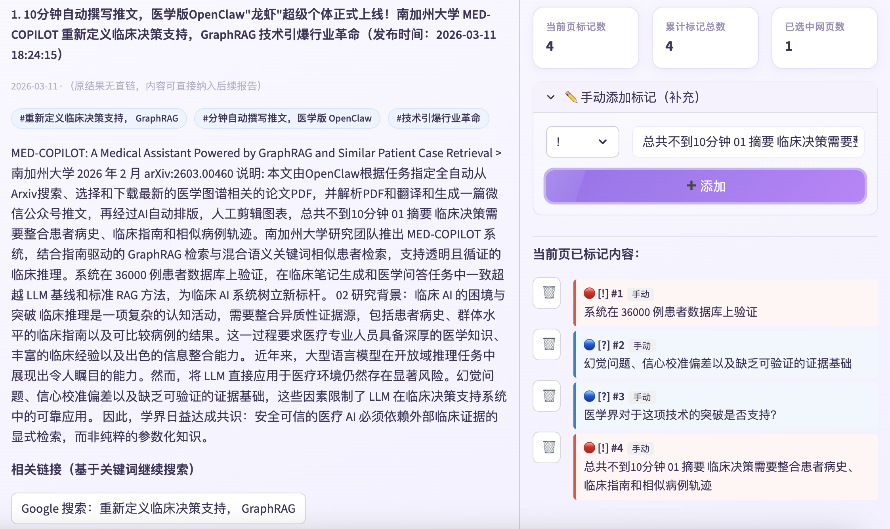
    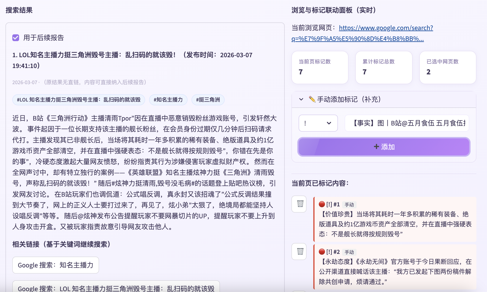
  </div>
  <!-- Figure Caption -->
  <p style="font-size:12px; color:#555; margin-top:6px;">
    <strong>Figure 7:</strong> GraphRAG Search Detail (left) — Entity & Relation Visualization in the Academic Search Scenario;  
    Qingyu Incident Search Detail (right) — Semantic and Contextual Highlighting in the Social Media Public Opinion Search Scenario.
  </p>
</div>


#### 4.3.2 Submodule II: Multi-Agent Deep Analysis

| Agent | Role | Responsibilities | Input | Output |
| :--- | :--- | :--- | :--- | :--- |
| **🤖 Agent-A** | User Trend Signal Analyst | Extract emerging trend signals, evolutionary patterns, and levels of user interest from User Attention Anchors. | User Attention Data (JSON) | Trend Signal Report |
| **🤖 Agent-B** | Contextual Evidence Evaluator | Extract evidence of technological evolution, timelines, and key milestones from retrieved web content. | Factual Web Content (JSON) | Technology Evolution Evidence Report |
| **🤖 Agent-C** | Event-Trend Relational Reasoner | Infer technological diffusion pathways and industry adoption dynamics from related events. | Related Event Data (JSON) | Event-Trend Correlation Report |
| **🤖 Agent-D** | Chief Strategic Integrator | Integrate the analytical outputs of Agent-A, Agent-B, and Agent-C into strategic documents for subsequent trend forecasting. | Enhanced Analytical Reports (A+B+C) | High-Quality Strategic Report (High Relevance, Timeliness, Factuality, and Personalization) |


💡 **In a Nutshell:**

> `Agent-A/B/C Sequential Trend Analysis + Agent-D Strategic Integration → Highly Relevant, Timely, Factual, and Personalized Reports`

Through the collaborative architecture of `Agent-A/B/C Sequential Trend Analysis + Agent-D Strategic Integration`, the system generates structured knowledge priors through in-depth multi-agent analysis.

Starting from <a style="color:#f77f00; text-decoration:none;" target="_blank">User Attention Anchors</a>, the system identifies emerging trend signals, extracts evidence of technological evolution, infers relationships between events and trends, and ultimately synthesizes these findings into high-quality strategic reports.

These reports establish a structured knowledge foundation for subsequent trend forecasting and future scenario simulation.

- **Customizable Analysis Mode:** Fast / Balanced / Deep
- **Adjustable Relevance Threshold**

<div style="text-align:center; margin:20px 0;">
  <!-- 图片行 -->
  <div style="display:flex; justify-content:center; gap:12px;">
    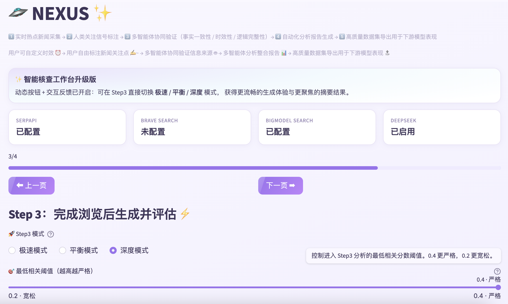
    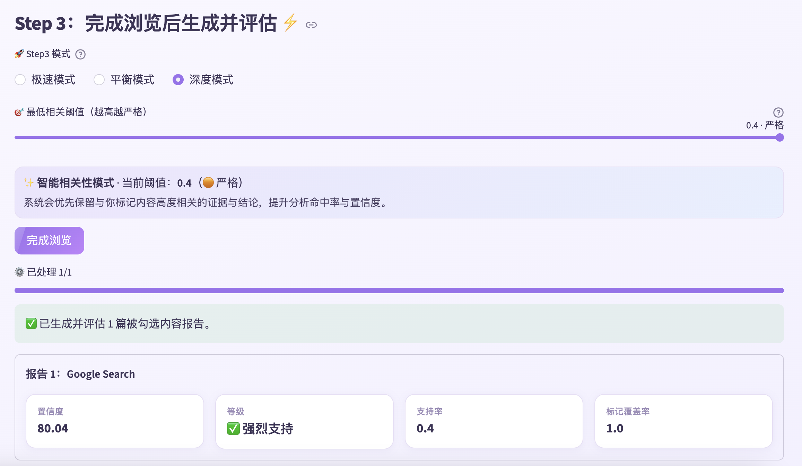
  </div>
  <!-- 图名 -->
  <p style="font-size:12px; color:#555; margin-top:6px;">
    <strong>Figure 8:</strong> Report Generation Interface (left) — User Input & Configuration;  
    Generated Report Result (right) — Structured Summary & Insights
  </p>
</div>


#### 4.3.3 Submodule III: Structured Knowledge Output

> This module integrates the analytical outputs of Agent-A, Agent-B, and Agent-C to generate high-quality strategic reports, providing structured knowledge priors for subsequent trend forecasting agents.

Explore the detailed reports below 👉:

<div style="display:flex; justify-content:center; gap:12px; flex-wrap:wrap; margin:20px 0;">

  <!-- Left Button: Preliminary Quantitative Evaluation Report -->
  <a href="assets/1_search/summary_report_20260312_170235.json" target="_blank">
    
  </a>

  <!-- Right Button: Enhanced Analysis Report -->
  <a href="assets/1_search/agent_guide_20260313_104312.md" target="_blank">
    
  </a>

</div>


---

### 🌍 4.4 Module IV: Digital Cognitive Twin Sandbox — Canyon 🏜️

> **Objective:** Within a virtual digital cognitive twin environment, this module employs multiple virtual agents to simulate real-world public opinion dynamics, event evolution, and user attention, enabling in-depth insight generation and future scenario forecasting.

#### Step 1: Information Prior Construction

In this module, user-defined attention anchors, including topics of interest, key individuals or entities, and specific events, are first integrated with multi-source information streams.

Through structured information extraction and entity-relation modeling, an enhanced [GraphRAG representation](https://github.com/microsoft/graphrag) is constructed. Additional self-loop relations and multidimensional connections are introduced to establish a more complex and interconnected relational network, thereby enhancing the semantic depth and traceability of information.

> **Query:** GraphRAG-related Academic Research Scenario

```txt
# Entity & Relation Extraction

Technical Foundations
├─ RAG (Retrieval-Augmented Generation)
├─ Knowledge Graph
│   ├─ is A ...
│   └─ is Used In ...

Framework Tools
├─ GraphRAG
│   ├─ uses → RAG
│   └─ built on → Knowledge Graph

Application Systems
├─ MED-COPILOT
│   ├─ uses → GraphRAG
│   ├─ uses → Knowledge Graph
│   └─ has Risk → ⚠️ ...
...
```

|  | 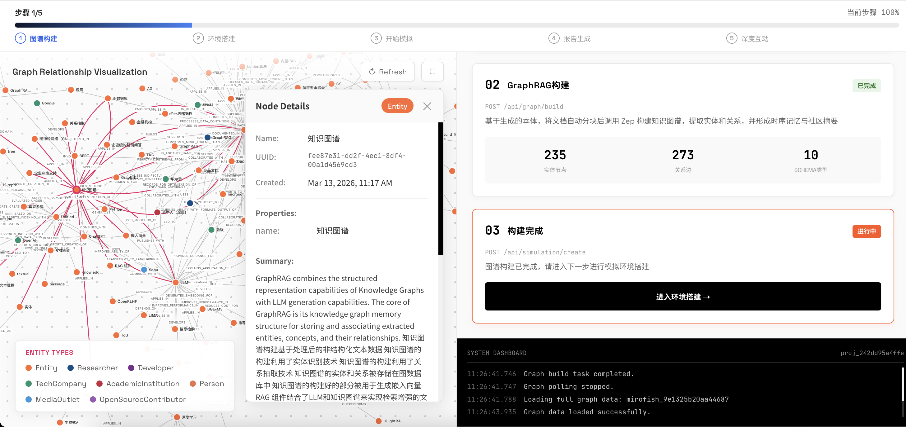 |
|:--:|:--:|
| **Figure 9a:** Entity & Relation Extraction — Extracting entities and relations from textual information and event streams to provide high-quality knowledge priors for GraphRAG. | **Figure 9b:** GraphRAG Construction — Transforming extracted entities and relations into a knowledge graph that supports relational reasoning and multidimensional connections. |


<a style="color:#f77f00; text-decoration:none;" target="_blank">Knowledge Graph Construction and Evolution: Step-by-Step Entity & Relation Modeling</a>

| 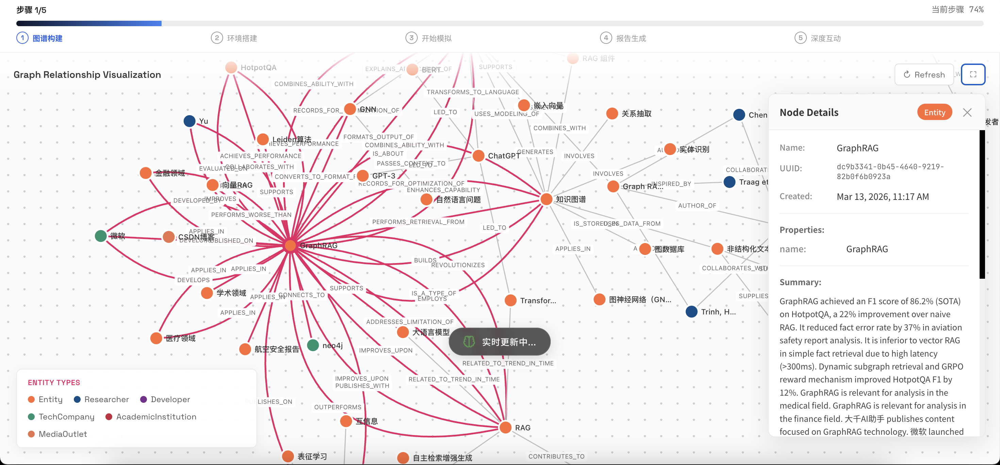 | 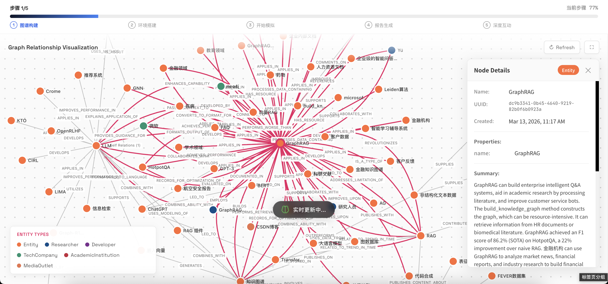 |
|:--:|:--:|
| **Figure 10a:** Initial Graph Construction — Importing entities and relations into the knowledge graph. | **Figure 10b:** Graph Expansion — Incorporating additional relational links and multidimensional connections. |

|  |  |
|:--:|:--:|
| **Figure 10c:** Graph Visualization — Visualizing the global network of nodes and relational structures. | **Figure 10d:** Complete Knowledge Graph Overview — Presenting the fully constructed knowledge graph, supporting multidimensional reasoning and querying. |


#### Step 2: Virtual Digital Cognitive Twin Construction and Virtual Agent Modeling

Based on the knowledge priors established in Step 1, the high-fidelity virtual environment Canyon is initialized with trending topics, contextual information, and activation sequences.

Multiple virtual agents are subsequently generated, each possessing a distinctive knowledge base, cognitive structure, behavioral tendencies, and data relationships. Users can customize the knowledge, interests, and behavioral patterns of these agents according to their specific requirements, enabling the simulation of cognitive behavior across different types of individuals within the virtual environment.

> Each virtual agent persona consists of:
> - **Basic Attributes:** Age, occupation, professional background, etc.
> - **Cognitive Characteristics:** Information processing preferences, decision-making styles, risk preferences, etc.
> - **Behavioral Tendencies:** Social interaction preferences and information-sharing habits.
> - **Influence:** Relative influence within the simulated information environment.

Selected virtual agent personas are presented below. Additional examples are available in [assets/2_canyon/step2](assets/2_canyon/step2).

<!--
- edged732 @Edge, D.
[AI researcher specializing in Graph Retrieval-Augmented Generation (GraphRAG)]

- graphrag_arxiv_paper_953 @Arxiv
[Research and dissemination platform for GraphRAG technologies]

- Developer_808 @Developer
[Technical community specializing in LLM application development, AI knowledge sharing, developer communication, and practical project support]

- neo4j_650 @neo4j
[Graph database technology provider specializing in knowledge graphs and AI applications]

- Reader_Group_792 @Readers
[AI algorithm engineer]
-->


<table>
  <thead>
    <tr>
      <th style="background-color:#B3CDE0; color:#000; padding:6px;">Virtual Agent</th>
      <th style="background-color:#B3CDE0; color:#000; padding:6px;">Identity Description</th>
      <th style="background-color:#B3CDE0; color:#000; padding:6px;">Basic Attributes</th>
      <th style="background-color:#B3CDE0; color:#000; padding:6px;">Cognitive Characteristics</th>
      <th style="background-color:#B3CDE0; color:#000; padding:6px;">Behavioral Tendencies</th>
      <th style="background-color:#B3CDE0; color:#000; padding:6px;">Influence</th>
    </tr>
  </thead>
  <tbody>
    <tr style="background-color:#E6F0FA; color:#000;">
      <td>edged732@Edge,D.</td>
      <td>AI researcher specializing in GraphRAG</td>
      <td>35 years old; researcher</td>
      <td>Prefers logical reasoning and graph-structured analysis; rigorous decision-making style; moderate risk preference</td>
      <td>Highly socially engaged; frequently shares academic resources and actively participates in technical community discussions</td>
      <td>Medium to high influence within the GraphRAG and knowledge graph domains</td>
    </tr>
    <tr style="background-color:#DFF2E1; color:#000;">
      <td>graphragArXiv_Paper_953@Arxiv</td>
      <td>Research and dissemination platform for GraphRAG</td>
      <td>Institutional agent focused on scientific research</td>
      <td>Prioritizes literature integration and maintains a neutral decision-making approach</td>
      <td>Disseminates research findings and follows academic developments</td>
      <td>High influence within the GraphRAG research community</td>
    </tr>
    <tr style="background-color:#FFF7CC; color:#000;">
      <td>Developer808@Developer</td>
      <td>Technical community for large language model application development</td>
      <td>Community-oriented agent focused on AI knowledge sharing</td>
      <td>Emphasizes practical implementation and case-based learning; favors experimental decision-making</td>
      <td>Frequently interacts with community members and actively shares code, models, and projects</td>
      <td>Medium to high influence, with efficient technology dissemination within the community</td>
    </tr>
    <tr style="background-color:#FFE5D4; color:#000;">
      <td>neo4j_650 @neo4j</td>
      <td>Graph database technology provider</td>
      <td>Enterprise agent with database expertise</td>
      <td>Data structure-oriented; emphasizes knowledge graph integrity and optimization</td>
      <td>Shares practical experience and provides technical consultation and tool support</td>
      <td>High influence in knowledge graph technologies and enterprise applications</td>
    </tr>
    <tr style="background-color:#F0F0F0; color:#000;">
      <td>Reader_Group_792 @Readers</td>
      <td>AI algorithm engineer</td>
      <td>User-oriented agent focused on algorithm research</td>
      <td>Prioritizes algorithmic understanding and engineering implementation; technology-driven decision-making</td>
      <td>Follows technical developments and participates in discussions and learning activities</td>
      <td>Medium influence, indirectly contributing to the ecosystem through information consumption and feedback</td>
    </tr>
  </tbody>
</table>


**Social Media Public Opinion Scenario — The Qingyu Tpor Account Destruction Incident on Bilibili (March 2026)**

The following table presents simulated stakeholder personas derived from the case study. Their cognitive characteristics, behavioral tendencies, and influence assessments represent simulation configurations and should not be interpreted as independently verified psychological profiles or factual accounts of individual behavior.

| Agent | Identity Description | Basic Attributes | Cognitive Characteristics | Behavioral Tendencies | Influence |
|:---|:---|:---|:---|:---|:---|
| **Affected Player (Wuyue Shiwu)** | A loyal fan of Bilibili streamer Qingyu Tpor and a long-term paying channel subscriber | Level-20 fan badge; experienced player since Season 1; paid channel membership; owns numerous discontinued in-game items; membership expired on February 28 | Continues the established practice of QR-code account login without noticing the membership expiration; trusts the streamer and prepares high-tier equipment for livestreaming; perceives a close relationship with the streamer | Repeatedly explains and appeals through live chat; urgently renews membership; publishes a detailed account of the incident; seeks legal assistance, rejects settlement, and pursues accountability | Central stakeholder and primary narrative source; legal action may influence the subsequent development of the case and broader discussions on virtual property protection |
| **Bilibili Platform** | Official livestreaming platform responsible for content governance and user rights protection | Institutional agent with account suspension authority, content moderation capabilities, and community rule-making responsibilities | Prioritizes content compliance, commercial partnership risks, and brand reputation; assesses incident severity through user reports and public opinion monitoring | Simulates account suspension decisions, internal review procedures, and cooperation with relevant authorities, based on the case timeline, including March 3 | Platform responses represent key turning points; response speed and enforcement measures influence public trust |
| **Fellow Streamer A (Opposing Qingyu)** | Gaming livestreamer publicly critical of Qingyu's reported conduct | Established follower base and industry influence; primarily associated with other gaming communities | Perceives the reported conduct as a violation of industry norms and a threat to trust between streamers and their audiences | Publishes critical videos and posts; encourages collective opposition; expresses dissatisfaction while seeking to protect industry reputation and professional interests | Mobilizes audience sentiment, generates collective industry pressure, and potentially amplifies concerns about trust within the livestreaming ecosystem |
| **Fellow Streamer B (Xuan Shen — Supporting or Sympathetic to Qingyu)** | Well-known League of Legends streamer modeled as expressing support for Qingyu's position | Large follower base; publicly recognizable and associated with contrarian commentary | Interprets account destruction as enforcement of livestream rules and associates unauthorized QR-code login with inappropriate behavior | Publicly expresses support for Qingyu's position, challenging the prevailing public sentiment and potentially intensifying controversy | Contrarian positioning may trigger secondary controversy, redirect public attention, and expose the stakeholder to reputational backlash |
| **Bystander C (Player / Accountability Advocate)** | Delta Force player or ordinary internet user concerned about the reported account destruction | Strong concern for fairness and accountability; potential capacity for collective organization, joint complaints, and public opinion mobilization | Perceives the reported conduct as a violation of player trust and virtual property rights; questions the unilateral enforcement of unfair livestream rules | Expresses criticism in comment sections, participates in collective complaints, and calls for accountability; extreme modeled responses may include privacy violations, harassment, and other harmful conduct | Public anger contributes to rapid information diffusion and controversy escalation; extreme responses introduce secondary social and legal risks |
| **Bystander D (Casual Observer)** | Gaming or non-gaming internet user attracted by the growing popularity of the incident | Large and diverse online audience with varying levels of gaming knowledge; primarily encounters the incident through trending topics and algorithmic recommendations | Initially attracted by the controversy surrounding the reported conduct; develops preliminary awareness of virtual property rights; some may become more actively engaged | Observes, shares, and comments on the incident, contributing to its visibility; some may adopt opposing positions, potentially increasing the risk of online harassment | Contributes to the long-tail attention of the incident; shifts in audience interest influence its public visibility and lifecycle |

---

> The following figures illustrate the progressive construction of virtual agent personas, cognitive structures, and behavioral patterns.

|  | 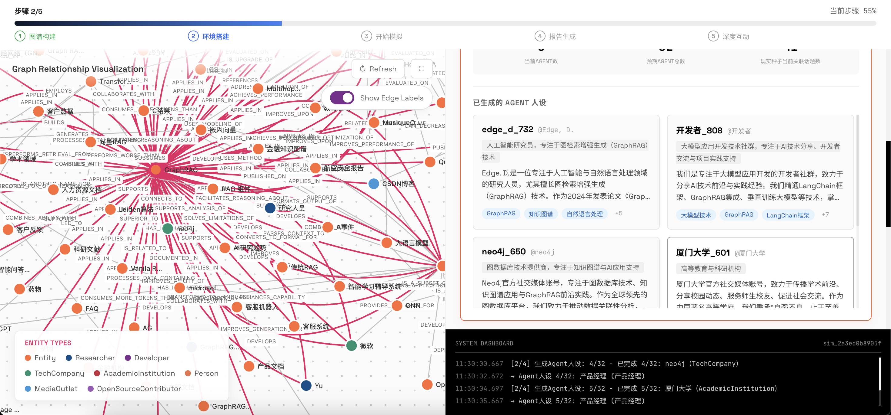 |
|:--:|:--:|
| **Figure 11a:** Initial Agent Persona Construction — Establishing basic attributes. | **Figure 11b:** Agent Persona Expansion — Incorporating individual preferences and behavioral tendencies. |

| 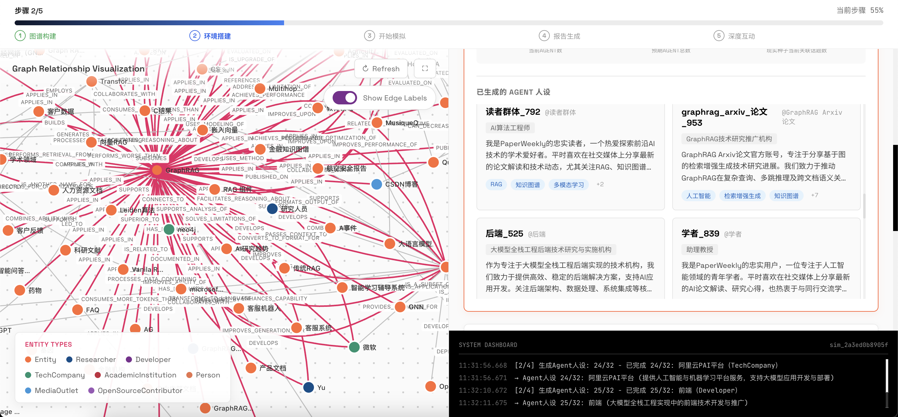 |  |
|:--:|:--:|
| **Figure 11c:** Agent Persona Optimization — Refining cognitive strategies, personality-driven cognitive tendencies, and interaction patterns. | **Figure 11d:** Agent Persona Completion — Establishing comprehensive cognitive structures and coherent behavioral patterns grounded in real-world seed information. |

| 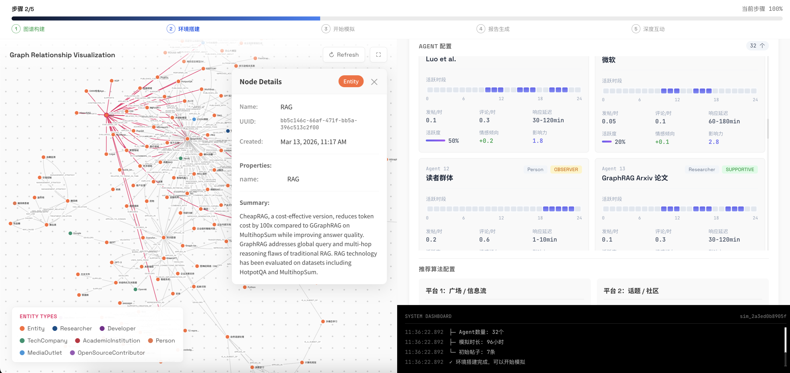 |  |
|:--:|:--:|
| **Figure 11e:** Agent Persona Configuration — Customizing attributes and preferences according to specific user requirements. | **Figure 11f:** Agent Persona Inspection — Examining individual agents' event-related cognition and behavioral characteristics. |


#### Step 3: Virtual Environment Simulation & Human-Like Agent Interaction

Within the Canyon Digital Cognitive Twin environment, the system simulates the evolution of real-world public opinion while incorporating environmental factors to guide information flows and public discourse. It aims to reproduce realistic information propagation pathways and public opinion dynamics.

This stage incorporates real-world event factors and models public opinion evolution, emerging topic aggregation, and information diffusion patterns, establishing a foundation for subsequent trend analysis.

|  |  |
|:--:|:--:|
| **Figure 12a:** Hot Topic Detection — Identifying topics receiving significant attention within the Canyon virtual environment. | **Figure 12b:** Canyon Simulation Overview — Presenting overall system operations and event-stream structures. |

|  | 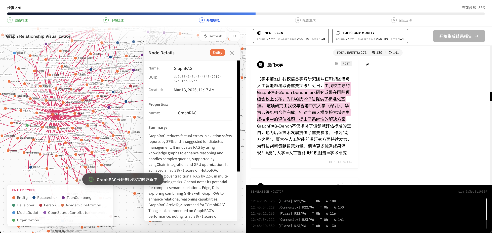 |
|:--:|:--:|
| **Figure 12c:** Virtual Agent Dialogue Example 1 — Demonstrating interactions between agents discussing trending topics. | **Figure 12d:** Virtual Agent Dialogue Example 2 — Illustrating different agents' simulated responses to events and cognitive reasoning processes. |


#### Step 4: Multi-Round Simulation and Event Evolution Analysis

The system performs multiple rounds of iterative simulation within the virtual environment and generates event evolution reports covering emerging events, public opinion diffusion trends, and key turning points.

Meanwhile, the system records the simulated responses and behavioral patterns of individual virtual agents, providing deep insights and interactive querying capabilities.

The multi-perspective data generated through simulation can be used to explore potential future trends. The system also generates simulated interviews grounded in real-world contextual information, helping users explore individual decision-making patterns and information response mechanisms.

<span style="color:#f77f00;">This project compares two distinct information environments:</span>

> ##### 🧑‍🏫 Simulated Face-to-Face Interviews

- <span style="color:#f77f00;">Academic Research Scenario</span> — using the technological development of GraphRAG as an example.

- <span style="color:#f77f00;">Social Media Public Opinion Scenario</span> — using the Qingyu Tpor Account Destruction Incident on Bilibili (March 2026) as an example.

Through simulated interviews, we examine differences in cognitive characteristics, information processing approaches, and behavioral responses among different types of virtual agents when exposed to the same event.

The simulations illustrate potential differences in information propagation and individual responses between academic and social media environments, providing valuable references for subsequent trend analysis and scenario forecasting.

- **Academics:** GraphRAG Research
- **Social Media:** Qingyu Tpor Account Destruction Incident on Bilibili (March 2026)

|  | 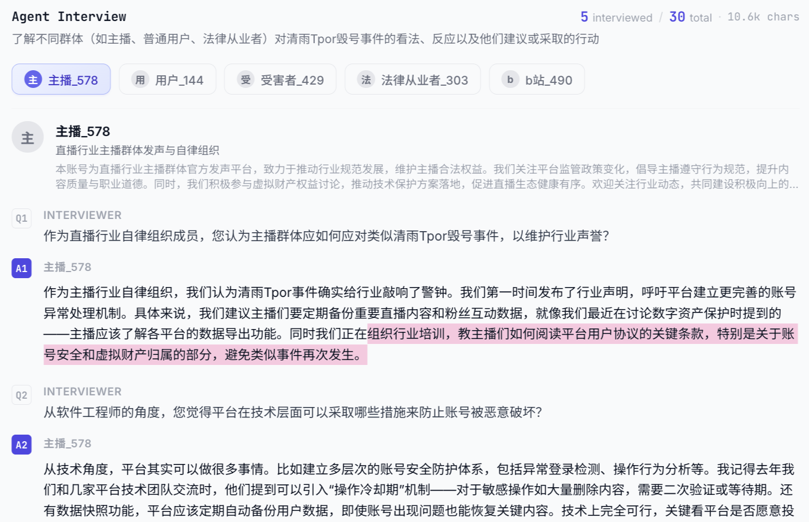 |
|:--:|:--:|
| **Figure 13a:** Academic Technology Expert Agent Interview — Exploring GraphRAG development trends and potential beneficiary application scenarios over the next five years. | **Figure 13b:** Social Opinion Streamer Agent Interview — Discussing the necessity of platform training and potential technical measures to prevent streamer misconduct. |

| 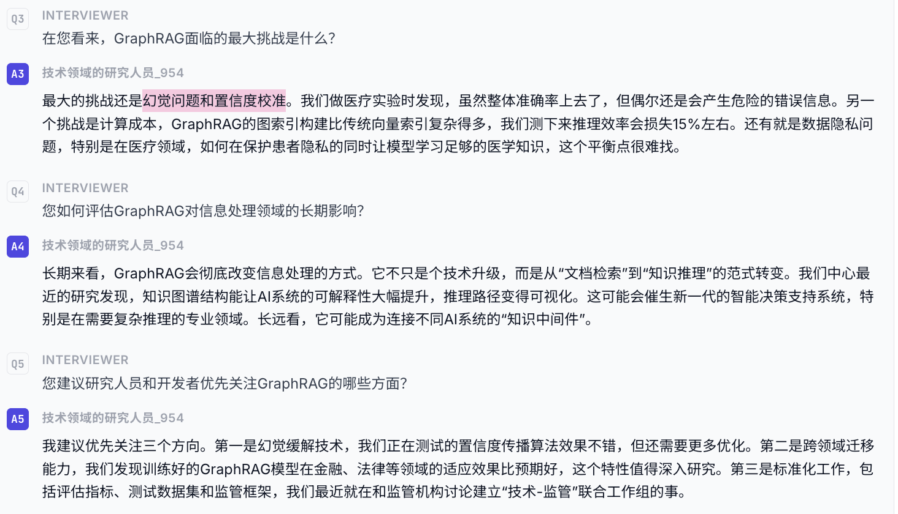 |  |
|:--:|:--:|
| **Figure 13c:** Academic Technology Expert Agent Interview — Exploring challenges associated with GraphRAG applications in healthcare and identifying RAG research priorities from an industry expert's perspective. | **Figure 13d:** Social Opinion Affected Player Agent Interview — Exploring the erosion of trust between users and streamers, alongside emerging discussions on virtual property protection policies. |

|  | 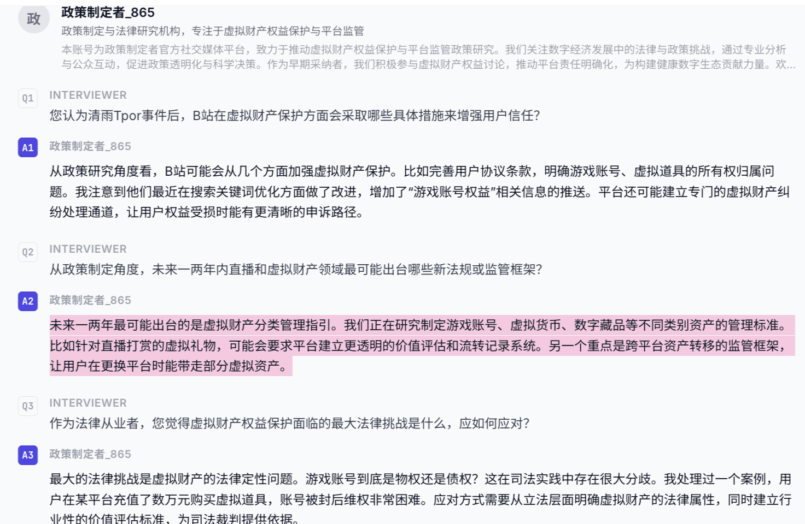 |
|:--:|:--:|
| **Figure 13e:** Academic Institutional Agent Interview — Examining potential GraphRAG applications and associated risks in financial institutions. | **Figure 13f:** Social Opinion Policymaker Agent Interview — Exploring policy clarification concerning virtual item ownership and the legal distinction between property rights and contractual claims. |

|  |  |
|:--:|:--:|
| **Figure 13g:** Academic Institutional Agent Interview — Analyzing the potential long-term impact of GraphRAG on the information technology sector and identifying key research priorities. | **Figure 13h:** Social Opinion Policymaker Agent Interview — Exploring the balance between freedom of content creation and platform accountability, including the allocation of legal responsibilities. |


---


> ##### 🔍 Deep Insight

<span style="color:#f77f00;">The Academic Research Scenario</span>, represented by **GraphRAG Technology Research and Development**, and <span style="color:#f77f00;">the Social Media Public Opinion Scenario</span>, represented by the **Qingyu Tpor Account Destruction Incident on Bilibili (March 2026)**, constitute two substantially different information ecosystems.

Through **Agent Interview Simulation** within the Canyon environment, we observe differences among virtual agents in their **cognitive frameworks, information understanding approaches, reasoning pathways, and behavioral response patterns** when addressing the same topic or event.

Agents in academic research scenarios tend to prioritize **structured knowledge integration, technological evolution analysis, and theoretical reasoning**.

In contrast, agents in social media public opinion scenarios tend to focus on **emotional diffusion, collective responses, and public opinion evolution**.

This comparative simulation illustrates potential differences in cognitive and information propagation mechanisms across information environments, providing valuable references for subsequent **Trend Analysis and Scenario Forecasting**.

- Academics: **GraphRAG Research**

- Social Media: **Qingyu Tpor Account Destruction Incident on Bilibili (March 2026)**


| 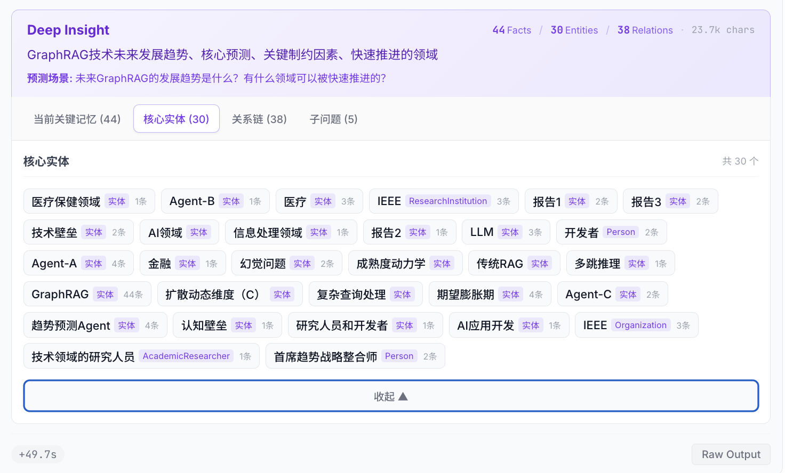 |  |
|:--:|:--:|
| **Figure 14a:** Entity-Level Insight (Academic — GraphRAG). Analyzing key entities and their relationships through GraphRAG to reveal structured knowledge connections and potential research pathways across academic topics. | **Figure 14b:** Entity-Level Insight (Social Opinion — Qingyu). Identifying prominent individuals, events, and organizations through entity-level analysis, and examining their influence and relationships within public opinion diffusion. |

|  | 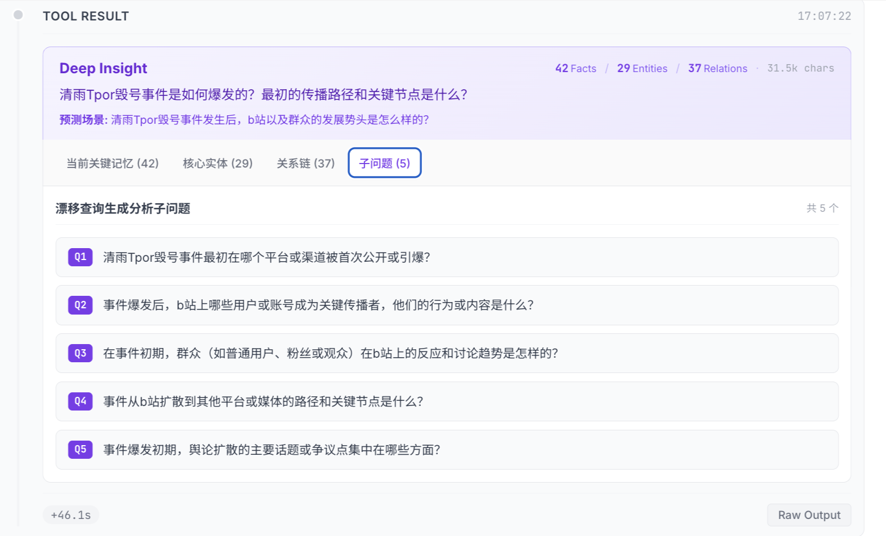 |
|:--:|:--:|
| **Figure 14c:** Question-Level Insight (Academic — GraphRAG). Applying question-driven reasoning, multi-hop knowledge retrieval, and information integration to generate deeper academic insights and theoretical interpretations. | **Figure 14d:** Question-Level Insight (Social Opinion — Qingyu). Applying question-driven reasoning to identify key issues of public concern and analyze interactions and diffusion trends among different perspectives. |


#### Step 5: Interactive Exploration and Deep Insights

Following simulated interviews and in-depth analysis, users can interact extensively with both generated simulation reports and individual virtual agents.

Through multi-round conversations and strategic exploration, users can examine the simulated reasoning pathways, underlying concerns, and potential behavioral tendencies of individual virtual agents, providing valuable support for strategic decision-making, risk forecasting, and trend analysis.

> 📊 **Structured Information Analysis:** By organizing simulation outputs into structured information, we summarize the key analytical dimensions of the academic technology scenario (GraphRAG Technology Evolution) and the social media public opinion scenario (Qingyu Tpor Incident on Bilibili, March 2026).

- Research topics and core questions.
- Development stages and key driving factors.
- Comparative analysis of industry impact, representative cases, and long-term trends.

The following comparison summarizes simulation-generated findings. Specific technology readiness estimates, business examples, and quantitative claims should be treated as analytical outputs requiring independent verification.

| Analytical Dimension | Academic / GraphRAG — Summary | Social Media / Bilibili Public Opinion — Summary |
|:---|:---|:---|
| **Research Topic** | **GraphRAG Technology Evolution**<br>Exploring the integration of Knowledge Graphs and LLMs, with a focus on complex knowledge reasoning, multi-hop retrieval, and the industrial deployment of explainable AI. | **Qingyu Tpor Account Destruction Incident (March 2026)**<br>Exploring social platform governance issues arising from virtual property loss, public opinion propagation mechanisms, and the boundaries of platform accountability. |
| **Core Questions** | How can GraphRAG enable structured knowledge retrieval, multi-hop reasoning, and reasoning explainability to enhance LLM-based decision support in specialized domains? | How should the legal status of virtual accounts and digital assets, streamer conduct standards, and platform governance responsibilities be defined? |
| **Current Stage** | The simulation estimates a transition from **Technology Readiness Level (TRL) 5–6 to TRL 6–7**, representing a gradual shift from laboratory validation toward enterprise-level application exploration. | Public discourse gradually shifts from initial emotional condemnation toward **in-depth institutional and legal discussions**. |
| **Key Driving Factors** | - Enhanced multimodal knowledge integration.<br>- Reinforcement Learning (RL) for retrieval and reasoning optimization.<br>- Incremental knowledge graph updates and real-time data integration. | - Discussions on streamer conduct standards.<br>- Legal classification of virtual property.<br>- Platform governance responsibilities and user rights protection. |
| **Industry Impact** | Potential early adoption in knowledge-intensive sectors such as **healthcare, finance, and law**, facilitating the development of enterprise knowledge systems and AI-powered decision-support platforms. | Potential improvements in **livestreaming conduct standards**, virtual asset dispute resolution mechanisms, and user rights protection. |
| **Representative Cases** | A simulation-generated example describes a leading securities firm applying **GraphRAG** to compliance review systems, improving review efficiency through automated retrieval of regulatory requirements and historical cases. | The **Qingyu Tpor Account Destruction Incident** is modeled as involving the loss of a fan's account data and widespread public discussion, with the simulation describing engagement on a scale of tens of millions. |
| **Long-Term Trends** | GraphRAG has the potential to become a foundational infrastructure component of enterprise AI knowledge systems, supporting the evolution of LLMs toward **explainable and verifiable professional decision-support systems**. | Potential improvements in virtual asset protection and platform governance frameworks, contributing to a **more standardized and institutionalized digital platform ecosystem**. |

---

> **Official Statements vs. Simulated Personal Reflections**
>
> 👀 Exploring deeper emotional, cognitive, and stakeholder perspectives beyond formal public statements.

The following examples are generated through virtual agent simulation. Both the official-style responses and personal reflections are synthetic outputs rather than authentic interviews, verified institutional statements, or factual representations of real individuals' private thoughts. Numerical examples are illustrative and have not been independently validated.


<table style="width:100%; border-collapse:collapse; font-family:Arial, sans-serif;">
  <thead>
    <tr style="background:linear-gradient(90deg, #a8cfff, #ffc899); color:white; text-align:center; font-weight:bold;">
      <th style="padding:8px; width:25%;">Scenario Comparison</th>
      <th style="padding:8px; width:37.5%;">Official-Style Statement (Simulated)</th>
      <th style="padding:8px; width:37.5%;">Personal Reflection (Simulated)</th>
    </tr>
  </thead>
  <tbody>
    <!-- GraphRAG Financial Application Scenario -->
    <tr style="border-bottom:1px solid #ccc; transition:background 0.3s;" onmouseover="this.style.background='#f0f8ff';" onmouseout="this.style.background='';">
      <td style="padding:10px; background:#79b0f5; color:white; font-weight:bold; text-align:center;">
        Academic / GraphRAG — Official Statements vs. Personal Reflections 💗
      </td>
      <td style="padding:10px; vertical-align:top;">
        From a professional exchange-data perspective, GraphRAG demonstrates potential revenue-generating applications in the financial sector, particularly among leading institutions. The industry remains cautiously optimistic about its technological potential while taking a prudent approach toward large-scale commercialization.
        <br><br>
        For example, an illustrative scenario involves a leading securities firm applying GraphRAG to optimize its compliance review system, reducing manual review time from 3–5 days to 2 hours, increasing accuracy from 78% to 92%, and reducing labor costs by 30%.
        <br><br>
        Institutional perspectives can be divided into three categories:
        <br><br>
        1. Technology teams are the most enthusiastic, actively exploring applications such as cross-market arbitrage and supply-chain risk propagation.
        <br><br>
        2. Risk management and compliance departments prioritize accuracy and explainability, placing particular emphasis on the reported 28% improvement in regulatory rule matching accuracy.
        <br><br>
        3. Business departments remain relatively conservative and require clear evidence of return on investment (ROI) before committing substantial resources.
      </td>
      <td style="padding:10px; vertical-align:top; color:#f77f00;">
        To be honest, this question makes me reflect on how our industry approaches emerging technologies. 😮‍💨 As a financial exchange data service provider, we often find ourselves both excited and concerned about technological innovation. 😨
        <br><br>
        <span style="color:#f77f00;">Our company began internally testing GraphRAG last year. It may still be too early to describe it as a direct revenue generator, but we have observed potential commercial value.</span>
        <br><br>
        For example, a simulated deployment at a mid-sized securities firm suggests that GraphRAG could help identify upstream and downstream corporate risk propagation pathways and potentially improve analyst efficiency by 30%.
        <br><br>
        <span style="color:#f77f00;">At a simulated financial technology roundtable, participants generally viewed GraphRAG as being at the technology validation stage.</span>
        <br><br>
        A hypothetical participant commented: “The concept is exciting, but integrating it into a live trading system would make me nervous.”
        <br><br>
        My main concern is model hallucination, given the exceptionally high accuracy requirements of financial applications. 😓
      </td>
    </tr>
    <!-- Platform Governance and Regulatory Policy Scenario -->
    <tr style="border-bottom:1px solid #ccc; transition:background 0.3s;" onmouseover="this.style.background='#fff4e6';" onmouseout="this.style.background='';">
      <td style="padding:10px; background:#ffad6e; color:white; font-weight:bold; text-align:center;">
        Social Media / Bilibili — Official Statements vs. Personal Reflections 💗
      </td>
      <td style="padding:10px; vertical-align:top;">
        The simulated policy position is clear: QR-code-based account login should not be eliminated entirely. Instead, platforms should strengthen security mechanisms and improve risk awareness among streamers and users.
        <br><br>
        Although QR-code-based login provides convenience, it also introduces potential security risks. Recommended measures include:
        <br><br>
        1. Introducing risk warning messages before QR-code authorization, clearly communicating potential risks to users.
        <br><br>
        2. Establishing temporary authorization mechanisms to restrict operational permissions following account access.
        <br><br>
        3. Providing operation logs and traceability mechanisms for streamer activities.
        <br><br>
        Rather than implementing a blanket prohibition, platforms should establish standardized governance mechanisms that balance convenience and security.
      </td>
      <td style="padding:10px; vertical-align:top; color:#ff9e3b;">
        This issue presents a difficult dilemma. 😮‍💨
        <br><br>
        <span style="color:#ff9e3b;">Imagine losing accumulated donations and fan-related data overnight, without an effective means of recovering them.</span>
        <br><br>
        Calls for clearer platform accountability may not always lead to immediate or satisfactory outcomes. 🏳️
        <br><br>
        Many small streamers depend on QR-code-based interactions to build their audiences during the early stages of their careers.
        <br><br>
        <span style="color:#ff9e3b;">In one illustrative scenario, a small streamer gains 5,000 followers in a month through QR-code-based interactions, making this feature important to their livelihood.</span>
        <br><br>
        I would prefer platforms to establish comprehensive protection mechanisms rather than simply eliminating the feature, ensuring that virtual property remains adequately protected.
      </td>
    </tr>
  </tbody>
</table>


---


<!-- Detailed Analytical Report Links -->
<p style="font-size:15px; color:#666; margin-top:10px;">
  📑 <b>Detailed Analytical Reports</b><br>
  The full reports provide extended analysis, generated agent reasoning summaries, and deeper insights into both the academic GraphRAG research scenario and the social media public opinion simulation.
</p>

<div style="text-align:center; margin-top:10px; display:flex; justify-content:center; gap:10px; flex-wrap:wrap;">

  <a href="assets/ans_report_interview/ansInterview_GraphRAG.md"
     style="background:#2b7de9; color:white; padding:8px 16px; border-radius:8px; text-decoration:none; font-size:13px; display:inline-block;">
    📘 View Full Academic Report (GraphRAG)
  </a>

  <a href="assets/ans_report_interview/ansInterview_Tpor.md"
     style="background:#ff7a18; color:white; padding:8px 16px; border-radius:8px; text-decoration:none; font-size:13px; display:inline-block;">
    🔥 View Full Social Analysis (Qingyu Event)
  </a>

</div>


|  | 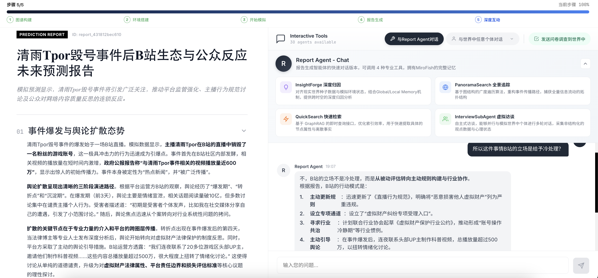 |
|:--:|:--:|
| **Figure 15a:** GraphRAG Analytical Report — A comprehensive report generated within the academic research scenario, integrating structured knowledge and multi-hop reasoning to summarize GraphRAG development trends, research directions, and potential application domains. | **Figure 15b:** Qingyu Event Report — A public opinion analysis report on the Qingyu Tpor Account Destruction Incident on Bilibili (March 2026), summarizing event context, information diffusion, platform ecosystem implications, and key issues of public concern. |

|  | 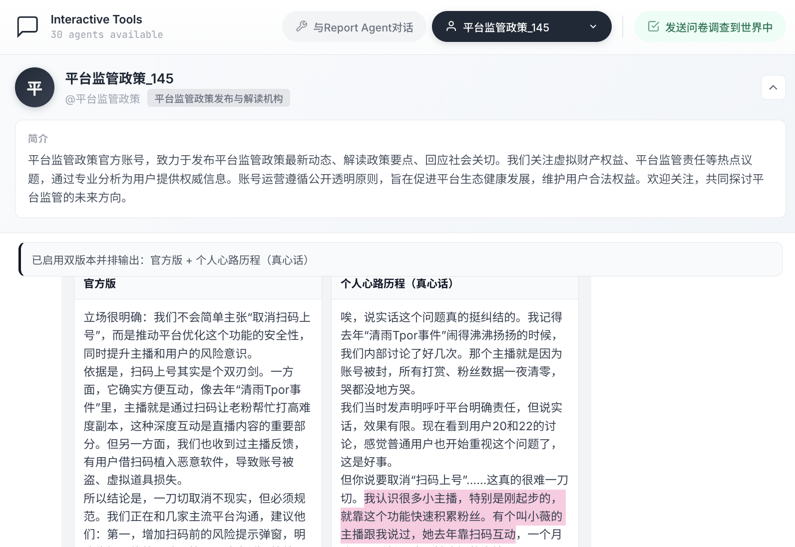 |
|:--:|:--:|
| **Figure 15c:** GraphRAG Agent Mindset — Generated cognitive reflections and analytical summaries following academic agent interviews, illustrating simulated interpretations of future GraphRAG development, research challenges, and potential technological breakthroughs. | **Figure 15d:** Qingyu Agent Mindset — Simulated emotional and cognitive responses to the incident, illustrating differences in attitudes among virtual agents and their perspectives on platform governance. |
---

## 📚 5. References

### 🧠 Academic & Technical Literature

1. **Nguyen, N. T., et al.** (2018). *A Capsule Network‑based Embedding Model for Search Personalization*. arXiv:1804.04266.
   📄 [https://arxiv.org/abs/1804.04266](https://arxiv.org/abs/1804.04266)

2. **Farshidi, F., et al.** (2024). *Understanding User Intent Modeling for Conversational Recommender Systems*. *User Modeling and User‑Adapted Interaction*, Springer Nature.
   🔗 [https://link.springer.com/article/10.1007/s11257-024-09398-x](https://link.springer.com/article/10.1007/s11257-024-09398-x)

3. **Guo, Q., et al.** (2025). *Beyond Static Retrieval: Opportunities and Pitfalls of Iterative Retrieval in GraphRAG*. arXiv:2509.25530.
   📄 [https://arxiv.org/abs/2509.25530](https://arxiv.org/abs/2509.25530)

4. **Zhu, Y., et al.** (2025). *Conversational Intent‑Driven GraphRAG*. arXiv:2506.19385.
   📄 [https://arxiv.org/abs/2506.19385](https://arxiv.org/abs/2506.19385)

5. **Zhong, V., et al.** (2025). *Beyond Sentiment: Cognitive and Narrative Open‑Ended Generation*. arXiv:2502.13925v1.
   📄 [https://arxiv.org/html/2502.13925v1](https://arxiv.org/html/2502.13925v1)

6. **Saunders, R.** (2012). *Towards Autonomous Creative Systems: A Computational Approach*. *Cognitive Computation*.
   🔗 [https://www.researchgate.net/publication/257788397_Towards_Autonomous_Creative_Systems_A_Computational_Approach](https://www.researchgate.net/publication/257788397_Towards_Autonomous_Creative_Systems_A_Computational_Approach)

---

## 💻 6. Code Repositories & Tools

### 📌 Knowledge-Augmented & Retrieval-Based Models

| Repository | Focus | Description |
| :--- | :--- | :--- |
| [Microsoft GraphRAG](https://github.com/microsoft/graphrag) | Knowledge Graph-Enhanced RAG | Integrates knowledge graphs with retrieval-augmented generation to enhance complex reasoning and multi-hop retrieval. |
| [Enterprise-Enhanced LLaMA Factory Pro](https://github.com/SuleynanAuir/Enterprise-Enhanced-LLaMA-Factory-Pro-Advanced-FineTuning-Local-Deployment-Pipeline) | Advanced Fine-Tuning | An enterprise-oriented LLaMA fine-tuning pipeline integrating data augmentation, LoRA/QLoRA fine-tuning, and local deployment via Ollama. |
| [CognitiveTemp DeepSearch Agents](https://github.com/SuleynanAuir/CognitiveTemp-DeepSearch-Agents) | User Preference-Driven Search | Implements deep search agents guided by user attention anchors and personalized information needs. |
| [UPAIRS-Agents](https://github.com/SuleynanAuir/UPAIRS-Agents) | Pressure-Driven Deep Search | Implements a pressure-driven search architecture with paragraph-level iterative reflection. |
| [DeepSearchAgent-Demo](https://github.com/666ghj/DeepSearchAgent-Demo) | Multi-Step Search | A demonstration of deep search agents capable of executing multi-step information retrieval tasks. |

### 🔍 Auxiliary Tools & Supporting Libraries

| Repository | Focus | Description |
| :--- | :--- | :--- |
| [Hypothesis h-api](https://github.com/hypothesis/h-api) | Web & PDF Annotation | Provides highlighting and annotation interfaces for capturing user interests and attention signals. |
| [Ollama](https://github.com/ollama/ollama) | Local LLM Deployment | Supports the local deployment and inference of various large language models. |
| [LoRAFusion](https://github.com/ASU-ESIC-FAN-Lab/LoRAFusion) | LoRA Weight Fusion | A toolkit for combining multiple LoRA weights to support model adaptation and extension. |
| [llama.cpp](https://github.com/ggml-org/llama.cpp) | Lightweight LLM Inference | A lightweight and efficient C/C++ implementation for large language model inference. |
| [easy-dataset](https://github.com/ConardLi/easy-dataset) | Dataset Management | Simplifies dataset construction, transformation, and partitioning workflows. |

---

## 📚 7. Citation References (BibTeX)

The following BibTeX entries provide references to the literature 
related to this project, covering search personalization, user 
intent modeling, GraphRAG, cognitive generation, and autonomous 
creative systems.

<details>
<summary><b>Click to expand BibTeX references</b></summary>

```bibtex
@article{nguyen2018capsule,
  title={A Capsule Network-based Embedding Model for Search Personalization},
  author={Nguyen, Nam Tran and others},
  journal={arXiv preprint arXiv:1804.04266},
  year={2018}
}

@article{farshidi2024understanding,
  title={Understanding User Intent Modeling for Conversational Recommender Systems},
  author={Farshidi, F. and others},
  journal={User Modeling and User-Adapted Interaction},
  year={2024},
  doi={10.1007/s11257-024-09398-x}
}

@article{guo2025graphrag,
  title={Beyond Static Retrieval: Opportunities and Pitfalls of Iterative Retrieval in GraphRAG},
  author={Guo, Q. and others},
  journal={arXiv preprint arXiv:2509.25530},
  year={2025}
}

@article{zhu2025conversational,
  title={Conversational Intent-Driven GraphRAG},
  author={Zhu, Y. and others},
  journal={arXiv preprint arXiv:2506.19385},
  year={2025}
}

@article{zhong2025beyond,
  title={Beyond Sentiment: Cognitive and Narrative Open-Ended Generation},
  author={Zhong, V. and others},
  journal={arXiv preprint arXiv:2502.13925v1},
  year={2025}
}

@article{saunders2012autonomous,
  title={Towards Autonomous Creative Systems: A Computational Approach},
  author={Saunders, R.},
  journal={Cognitive Computation},
  volume={4},
  number={3},
  pages={216--225},
  year={2012}
}
```

</details>

---

### ✔ Usage Guidelines

- **Academic Writing & Presentations:** Use the provided BibTeX 
  entries when citing relevant literature in research papers, 
  technical reports, and academic presentations.
- **Project Documentation:** Organize academic references and 
  software resources into separate categories to improve readability 
  and accessibility.
- **Repository Navigation:** Use descriptive hyperlinks and optional 
  badges to provide convenient access to related repositories.
