# NEXUS: Navigating Emergent X-agent Universe Simulator with Unprecedented Insight

> 🚀 From Information Streams to Simulatable Futures！

<div style="border-left: 4px solid #4CAF50; padding-left: 15px; background-color: #f7fcf7; padding: 10px; border-radius: 5px;">
    <p style="margin: 0; font-size: 1.05em; color: #333;">
        📞 Contact us here and welcome your coming !
    </p>
</div>

<ul style="list-style-type: none; padding-left: 0; margin-top: 15px;">
    <li style="margin-bottom: 10px; display: flex; align-items: center; gap: 10px;">
        <span style="color: #4CAF50; font-size: 1.2em;">👤</span> 
        <strong>Name:</strong> Minghao Li (Aiur), Yirui Liang (Loey)
    </li>
    <li style="margin-bottom: 10px; display: flex; align-items: center; gap: 10px;">
        <span style="color: #4CAF50; font-size: 1.2em;">🏫</span> 
        <strong>Affiliation:</strong> Beijing Normal - Hong Kong Baptist University (BNBU)
    </li>
    <li style="margin-bottom: 10px; display: flex; align-items: center; gap: 10px;">
        <span style="color: #4CAF50; font-size: 1.2em;">📧</span> 
        <strong>Email:</strong> <code>t330034027@mail.uic.edu.cn, laybaeknim@gmail.com</code>
    </li>
</ul>


<div align="left">
  <a href="https://suleynanauir.github.io/NEXUS-Navigating-Emergent-X-agent-Universe-Simulator-with-Unprecedented-Insight/">
    
  </a>
  <a href="survey/NEXUS_report.pdf">
  
  </a>
  <a href="assets/demo/demo.pdf">
    
  </a>
  
  
</div>

<p align="center">
  NEXUS says NO to formulaic writing and repetitive content 🙅, 
  delivering authentic, relevant information tailored to your actual needs ✅. 
  By integrating dynamic real-world factors and exploring diverse perspectives, 
  NEXUS breaks conventional thinking and inspires innovative ideas 💥. 
  Powered by a high-speed analysis engine with a 60% improvement in efficiency, 
  NEXUS enables you to uncover deep insights that would otherwise require days 
  of data collection — in just 30 minutes, at a cost of only ¥2 🔍.
</p>

<p align="center">
  <span style="font-size:20px; color:#e63946;">🌙✨</span>
  <span style="font-size:20px; color:#f77f00; font-weight:bold;">Anticipate the Unseen.</span><br>
  <span style="font-size:20px; color:#2a9d8f; font-weight:bold;">Understand the Emerging. 🌌</span>
</p>


<p align="center">
  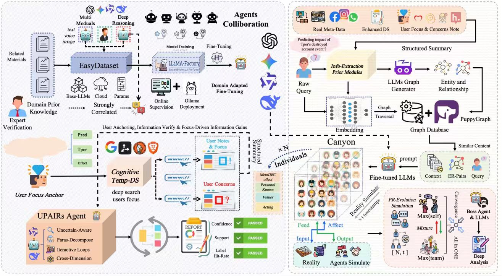
</p>
<p align="center">
  <span style="display:inline-block; background:#f8fafc; padding:1rem 2.2rem; border-radius:60px; font-size:1.2rem; color:#1e293b; border:1px solid #e2e8f0; box-shadow:0 4px 10px rgba(0,0,0,0.03);">
    <b>NEXUS Framework:</b> Domain-Specific Fine-Tuning × Deep Search × User Attention-Driven Reasoning × Digital Cognitive Twin — A Collaborative Multi-Agent Framework that Breaks Conventional Thinking and Redefines Intelligent Content Generation.
  </span>
</p>


<div align="center">
  <!-- 
    图片清晰度提示：
    - 为保证清晰，请使用宽度至少 1800px 的高分辨率图片（适配 2 倍屏）。
    - 此处设置 width="900"（固定像素），同时用 max-width:100% 保证移动端不溢出。
    - 如果原始图片宽度不足 900px，显示会模糊，请务必使用足够大的图片。
  -->
  
  <br><br>
  <a href="#step-1-information-prior-construction"
     style="display:inline-block;
            background:linear-gradient(135deg, #ff7a18, #ffb347, #ffa751);
            background-size:200% 200%;
            color:white;
            font-family:'Segoe UI', Roboto, system-ui, sans-serif;
            font-weight:600;
            font-size:1.2rem;
            letter-spacing:0.02em;
            padding:1rem 2.8rem;
            border-radius:60px;
            text-decoration:none;
            border:none;
            box-shadow:0 15px 25px -8px rgba(255,122,24,0.4),
                       0 4px 8px rgba(0,0,0,0.1),
                       inset 0 1px 2px rgba(255,255,255,0.6);
            cursor:pointer;
            transition:all 0.3s cubic-bezier(0.2,0.9,0.4,1);
            background-position:0% 0%;">
    🔍 View Highlight Detail
  </a>
</div>


<!-- 三张图片等宽度纵向排布 -->
<!-- 使用仿照示例的居中容器与图片样式，确保清晰度与视觉一致性 -->

<p align="center">
  <!-- 图片1：分组雷达图（学术风格） -->
  <!-- 固定宽度 1000 确保清晰，同时添加圆角与阴影，max-width 适配移动端 -->
  
</p>

<p align="center">
  <!-- 图片2：稳定性相关图表 -->
  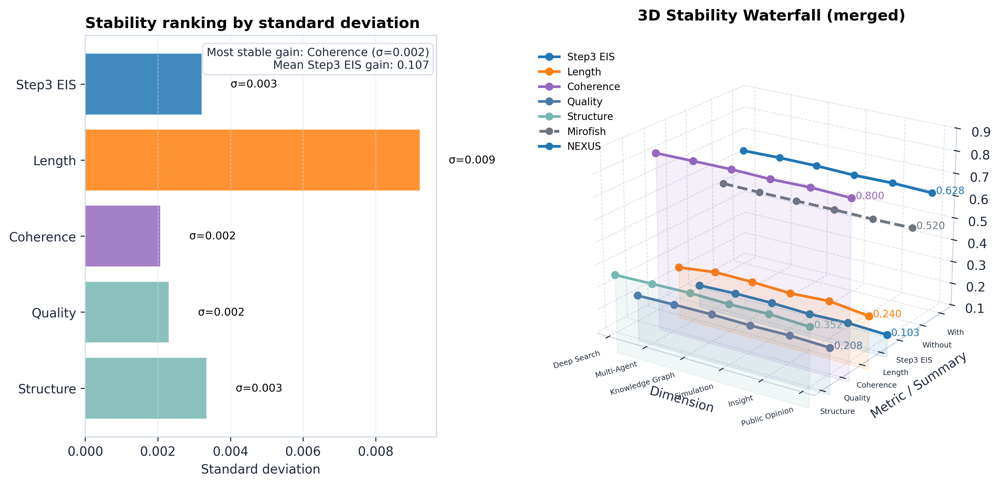
</p>

<p align="center">
  <!-- 图片3：分布相关图表 -->
  
</p>


## 📊 1. Preview

> NEXUS bridges the gap between **Information Analysis** and **Social System Simulation** by integrating authentic, verified real-world information streams.

### 🌟 Key Features of NEXUS

- 🚀 **Beyond Generic Content — Personalized Cognitive Insights** 🔥🔥🔥

    Achieving cognitive breakthroughs based on users' genuine interests and information needs.

    - Conduct deep searches focused on <u>what users genuinely care about</u>, rather than <del>generic and superficial information</del>. 🙅
    - Construct a <u>personalized Cognitive Map</u> for each user, rather than relying on <del>one-size-fits-all analysis</del>.
    - 📖 **Related Literature:**
        - Farshidi et al. (2024), *Understanding User Intent Modeling for Conversational Recommender Systems*, [🔗 Springer Nature](https://link.springer.com/article/10.1007/s11257-024-09398-x)
        - Nguyen et al. (2018), *A Capsule Network-based Embedding Model for Search Personalization*, [🔗 arXiv](https://arxiv.org/abs/1804.04266)

- 🔗 **Beyond Redundant Data — High-Quality Information Integration** 🔥🔥

    Combining highly relevant deep search results with reliable information sources.

    - Integrate <u>domain-specific fine-tuned models</u>, rather than relying solely on <del>general-purpose LLMs</del>. 🙅
    - Implement a **User Attention Anchor-Driven Information Understanding Mechanism**, rather than <del>indiscriminate information processing</del>.

- 📈 **Beyond Prediction — Dynamic Simulation of Emerging Trends**

    - Incorporate **authentic, real-time, and dynamically evolving real-world factors** 🔥🔥, rather than <del>static or idealized assumptions</del>. 🙅
    - Construct a <u>high-fidelity Digital Cognitive Twin</u>, rather than <del>virtual environments based on idealized assumptions</del>. 🙅
    - 📖 **Related Literature:**
        - Guo et al. (2025), *Beyond Static Retrieval: Opportunities and Pitfalls of Iterative Retrieval in GraphRAG*, [🔗 arXiv](https://arxiv.org/abs/2509.25530)
        - Zhu et al. (2025), *Conversational Intent-Driven GraphRAG*, [🔗 arXiv](https://arxiv.org/abs/2506.19385)

- 💡 **Beyond Conventional Knowledge — Innovative and In-Depth Insights**

    Encouraging cognitive breakthroughs through diverse perspectives and out-of-the-box reasoning.

    - Generate **novel and thought-provoking ideas** 🔥🔥, rather than <del>rigid analysis or repetitive conventional wisdom</del>. 🙅
    - Generate **realistic simulated internal monologues and cognitive narratives** 🔥, rather than <del>superficial interpretations of individual behavior</del>. 🙅
    - 📖 **Related Literature:**
        - Zhong et al. (2023), *Beyond Sentiment: Cognitive and Narrative Open-Ended Generation*, [🔗 arXiv](https://arxiv.org/html/2502.13925v1)
        - Saunders (2012), *Towards Autonomous Creative Systems: A Computational Approach*, *Cognitive Computation*, 4(3), 216–225. [🔗 Article](https://www.robsaunders.net/publication/towards-autonomous-creative-systems-a-computational-approach/)

- 🌐 **Beyond a Single Perspective — Multi-Perspective Future Simulation** 🔥🔥🔥

    NEXUS supports the simulation of complex information environments from multiple stakeholder perspectives:

    - ⚖️ **Governments and Policymakers:** policymakers, regulatory authorities, and policy think tanks.
    - 💰 **Enterprises and Market Participants:** investment institutions, corporations, business intelligence organizations, venture capital (VC), and private equity (PE) firms.
    - 🧑‍🤝‍🧑 **Public Opinion and Social Communities:** social media users, key opinion leaders (KOLs), the general public, NGOs, and opinion amplifiers.
    - 🧑‍🔬 **Researchers and Expert Networks:** academic researchers, industry experts, and independent researchers.

- ⚡ **Beyond Simulation Volume — Greater Diversity, Higher Efficiency, and Deeper Insights** 🔥🔥🔥

    > This optimization enables high-frequency simulation while facilitating rapid insight generation and timely decision-making under limited computational and financial resources.

    - Compared with the original **MiroFish architecture**, NEXUS achieves substantial efficiency improvements, reducing simulation costs by up to **60%** and simulation time to approximately one-third of the original duration.
    - By integrating **Background Knowledge Priors** with **User Attention Anchors**, together with optimized agent persona configurations, NEXUS substantially reduces token consumption while maintaining analytical depth.
    - **Optimized Inference Configuration:** A tailored optimization strategy for OpenAI GPT-4o reduces computational overhead, lowering the cost per simulation from **$5 to $2–3**, representing a **40–60% cost reduction**.
    - **Accelerated Deep Analysis:** NEXUS requires only **30 simulation rounds** to generate high-quality insights, compared with **96 rounds** in the original MiroFish framework. The total analysis time is reduced from **50 minutes to 18–20 minutes**, representing a **60–64% reduction in processing time**.

---

### 🧠 From Information Streams to Cognitive Simulation

`NEXUS` is a **Multi-Agent Cognitive Simulation Framework** designed for the analysis and simulation of complex real-world information environments.

Guided by `User Preference Anchors`, NEXUS proactively discovers in-depth insights and strategic solutions aligned with users' cognitive objectives.

The framework systematically integrates highly relevant and reliable multi-source information, including **social media discourse, public opinion, policy developments, and financial intelligence**, establishing an end-to-end pipeline for intelligent information analysis and scenario simulation.

Through real-world information collection, semantic understanding, and relational reasoning, NEXUS reconstructs the underlying relationships and potential causal pathways between key events within a high-dimensional knowledge space.

By combining `Dynamic Simulation`, `Trend Projection`, and `Multi-Perspective Reasoning`, NEXUS aims to deliver deeper insights, explore emerging possibilities, and facilitate cognitive breakthroughs beyond conventional thinking.


## 🌐 2. What Can NEXUS Do?

### 🎭 Multi-Role Cognitive Simulation: Explore the World from Different Perspectives with NEXUS

NEXUS supports `multi-domain, multi-role, multi-perspective, and high-fidelity` simulation of complex information systems and future scenarios, enabling users to explore the following application scenarios:

#### 1️⃣ Decision Simulation Engine for Policymakers ⚖️

<p align="left">
  <a href="#step-4-multi-round-simulation-and-event-evolution-analysis">
    
  </a>
</p>

- 🔮 **Policy Ripple Effect Simulation:** Dynamically simulate the potential economic, public opinion, and public safety consequences following policy implementation.
- ⚠️ **Early Risk Identification:** Identify potential social conflicts and public opinion crises, and generate possible intervention strategies.
- 📊 **Retrospective Policy Evaluation:** Analyze the potential effects and underlying causal relationships of policy adjustments to support evidence-informed decision-making.

#### 2️⃣ Business Simulation Lab for Enterprises and Market Decision-Makers 💰

<p align="left">
  <a href="#step-4-multi-round-simulation-and-event-evolution-analysis">
    
  </a>
</p>

- 🔮 **Emerging Trend Forecasting:** Integrate multi-source information and User Preference Anchors to *dynamically explore emerging industry trends and evolving consumer perceptions*.
- ⚔️ **Competitive Intelligence:** Simulate competitor actions and market responses to *evaluate the potential impact of product launches, pricing strategies, and marketing campaigns*.
- 🧪 **Strategic Scenario Evaluation:** Conduct market simulations across multiple scenarios to <u>explore trade-offs among profitability, market share, and brand reputation</u>.

#### 3️⃣ Public Opinion Intelligence for Individuals and Social Communities 🧑‍🤝‍🧑

<p align="left">
  <a href="#step-4-multi-round-simulation-and-event-evolution-analysis">
    
  </a>
</p>

- 📊 **Public Sentiment Analysis:** Track emerging social media discussions and <u>the dynamic evolution of public sentiment</u> in real time.
- 🎯 **Key Opinion Leader Identification:** Identify Key Opinion Leaders (KOLs) and <u>estimate their relative influence on public discourse and event development</u>.
- ⚡ **Public Opinion Crisis Early Warning:** Identify potentially escalating events and <u>simulate information diffusion patterns, propagation scale, and associated risk levels</u>.

#### 4️⃣ Knowledge Intelligence Network for Researchers and Experts 🧑‍🔬

<p align="left">
  <a href="#step-4-multi-round-simulation-and-event-evolution-analysis">
    
  </a>
</p>

- 🧠 **Knowledge Graph Construction:** Integrate academic publications, policy reports, and emerging technological developments into <u>a dynamic, searchable knowledge network that supports relational reasoning</u>.
- 🔮 **Emerging Research Trend Identification:** Leverage historical data and real-time information streams to <u>identify emerging technologies, market opportunities, and evolving research topics</u>.


<div align="center" style="margin:40px 0;">
  <!-- Highlight Image -->
  
  <br><br>
  <!-- Navigation Button -->
  <a href="#step-1-information-prior-construction">
    <button style="
      background:linear-gradient(90deg,#ff7a18,#ffb347);
      color:white;
      border:none;
      padding:12px 22px;
      font-size:15px;
      font-weight:600;
      border-radius:10px;
      cursor:pointer;
      box-shadow:0 6px 16px rgba(0,0,0,0.18);
      transition:all 0.25s ease;
    ">
      🔍 Explore NEXUS Highlights
    </button>
  </a>
</div>


## 🧩 3. Core Architecture

NEXUS establishes a cognitive simulation system through the following core mechanisms:

<p align="center">
  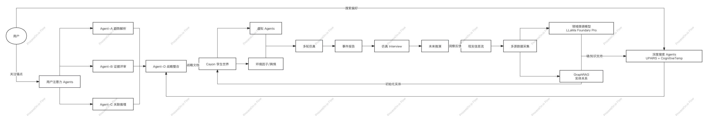
</p>

### 🚀 3.1 Core Workflow: From Real-World Information Streams to Future Scenario Simulation

> 💡 **Beyond Prediction — Simulating Possible Futures for Proactive Insights and Informed Decision-Making.**

- 🎯 **Step 1: Domain-Specific Fine-Tuning**  
**Focus on User Attention Anchors to enhance domain-specific understanding.**  
`#Targeted Fine-Tuning` `#Private Deployment` `#Attention Anchors`

    Leverage [LLaMa Foundary Pro](https://github.com/SuleynanAuir/Enterprise-Enhanced-LLaMA-Factory-Pro-Advanced-FineTuning-Local-Deployment-Pipeline), an integrated pipeline combining EasyDataset, LLaMA fine-tuning, and model deployment. By incorporating data augmentation and Ollama-based deployment, the pipeline enables efficient model adaptation to specific domains and user requirements.

- 🤖 **Step 2: Customized Deep Search Agents**  
**Discover in-depth insights closely aligned with users' cognitive objectives.**  
`#Deep Search` `#User-Controlled Retrieval` `#High-Fidelity Insights`

    Integrate [UPAIRS-Agents](https://github.com/SuleynanAuir/UPAIRS-Agents) to enhance information fidelity, relevance, and confidence. Combine it with [CognitiveTemp-DeepSearch-Agents](https://github.com/SuleynanAuir/CognitiveTemp-DeepSearch-Agents) to enable user-controlled retrieval, balancing information depth and search precision.

- 🤖 **Step 3: User Attention-Driven Information Understanding Agents**  
**Capture user interests in real time and generate strategic knowledge priors through collaborative multi-agent reasoning.**  
`#Attention-Driven Reasoning` `#Sequential Reasoning` `#Strategic Insights`

    Leverage Hypothesis to capture user annotations and attention signals in real time. Four specialized agents collaborate through a sequential reasoning pipeline:

    **Signal Analysis → Evidence Evaluation → Relational Reasoning → Strategic Integration**

    This process transforms fragmented information into structured, actionable strategic insights.

- 🌍 **Step 4: Digital Cognitive Twin — Canyon 🏜️**  
**Construct a high-fidelity virtual environment to simulate public opinion dynamics and decision-making processes.**  
`#Digital Cognitive Twin` `#Public Opinion Simulation` `#Simulated Interviews`

    Build knowledge graphs using [GraphRAG](https://github.com/microsoft/graphrag), generate diverse virtual agents, and incorporate environmental factors to model the evolution of public opinion.

    Canyon supports multi-round simulations, event evolution reports, and in-depth interviews with virtual agents, enabling users to explore potential future scenarios and underlying decision-making patterns.

- 🔁 **Step 5: End-to-End Cognitive Reasoning Loop**  
**Establish a complete reasoning loop from real-world information streams to future scenario simulation.**  
`#End-to-End Pipeline` `#Future Scenario Simulation` `#Decision Simulation`

    Integrate all preceding modules into a unified cognitive simulation framework that supports multi-role and multi-perspective reasoning. This enables users to explore potential outcomes, evaluate alternative strategies, and rehearse decisions in a virtual environment before implementing them in the real world.

### 📦 3.2 Module Overview

| Module | Functional Description | Implementation & Integrated Projects |
| :--- | :--- | :--- |
| 🎯 **Domain-Specific Fine-Tuning** | - Focus on **User Attention Anchors**.<br>- Enhance **domain-specific information understanding**. | Leverage [LLaMa Foundary Pro](https://github.com/SuleynanAuir/Enterprise-Enhanced-LLaMA-Factory-Pro-Advanced-FineTuning-Local-Deployment-Pipeline), an integrated pipeline for efficient model fine-tuning, incorporating data augmentation and Ollama-based local deployment. 🐑 |
| 🤖 **Customized Deep Search Agents** | Discover **in-depth insights closely aligned with users' cognitive objectives**. | - Integrate [UPAIRS-Agents](https://github.com/SuleynanAuir/UPAIRS-Agents) to improve information relevance and confidence.<br>- Incorporate [CognitiveTemp-DeepSearch-Agents](https://github.com/SuleynanAuir/CognitiveTemp-DeepSearch-Agents) to enable user-controlled search guided by User Attention Anchors. |
| 🤖 **User Attention-Driven Information Understanding Agents** | Capture user interests in search results in real time.<br><br>Employ a collaborative reasoning architecture: **Agent-A/B/C Sequential Trend Analysis + Agent-D Strategic Integration**, generating structured knowledge priors for subsequent simulation. | - **Hypothesis:** Capture user attention signals and annotations in real time. ✍️<br>- **Agent-A — User Trend Signal Analyst** 🔥: Extract emerging trend signals and levels of user interest from attention anchors.<br>- **Agent-B — Contextual Evidence Evaluator** 🤔: Extract evolutionary processes, timelines, and relevant supporting evidence.<br>- **Agent-C — Event-Trend Relational Reasoner** 🧠: Infer information diffusion pathways and industry dynamics from related events.<br>- **Agent-D — Chief Strategic Integrator** ✅: Synthesize analytical outputs into strategic reports for trend forecasting. |
| 🌍 **Digital Cognitive Twin — Canyon** 🏜️ | Construct a **high-fidelity virtual environment** to simulate real-world events, public opinion dynamics, and future scenarios by integrating complex real-world information streams. | - **Initialization:** Integrate high-quality knowledge priors and perform Entity & Relation (E&R) extraction to construct multidimensional knowledge graphs using [GraphRAG](https://github.com/microsoft/graphrag). 🌟<br>- **High-Fidelity Agent Modeling:** Generate diverse virtual agents with distinct knowledge bases, cognitive characteristics, and behavioral tendencies.<br>- **Public Opinion Dynamics Simulation:** Incorporate environmental factors to model information diffusion and the dynamic evolution of public opinion within Canyon.<br>- **Multi-Round Simulation & Event Evolution Reports:** Analyze public opinion propagation and virtual agent behavior, supporting in-depth **Simulated Interviews**. 🎤<br>- **Interactive Exploration & Insights:** Interact with simulation reports and individual virtual agents to explore potential future scenarios and support informed decision-making. |


## 🛠 4. Implementation & Engineering

### 🎯 4.1 Module I: Domain-Specific Fine-Tuning

> `Objective:` Focus on User Attention Anchors to enhance domain-specific information understanding, particularly in areas such as current affairs and public opinion.

> `All-in-One Pipeline:` Data Management → Data Augmentation → Model Fine-Tuning → Model Quantization → Local Deployment 📦

#### 4.1.1 Implementation Approach

- Leverage the independently developed project [LLaMa Foundary Pro](https://github.com/SuleynanAuir/Enterprise-Enhanced-LLaMA-Factory-Pro-Advanced-FineTuning-Local-Deployment-Pipeline), an integrated pipeline designed for efficient model fine-tuning, incorporating data augmentation and Ollama-based deployment. 🐑

    - > **Input:** User-defined data, including current affairs, social media discourse, financial news, policies, and regulations. The entire pipeline is `fully automated`, enabling the generation of augmented training data directly from unstructured sources such as PDF documents.

    - > **Output:** Fine-tuned models with enhanced domain-specific capabilities, real-time training performance monitoring, and deployment support.

#### 4.1.2 End-to-End Pipeline

- 1️⃣ **Cloud Infrastructure — [AutoDL](https://www.autodl.com/home)** ☁️

    Provides automated fine-tuning environments, preconfigured container images, model training, and integrated virtual environment (`.venv`) configuration and management.

    Supports cloud-based data storage (e.g., AWS S3 and Azure Blob Storage) and model repositories (e.g., Hugging Face Hub and Ollama Registry).

    - **Hardware Configuration:** Select appropriate hardware resources according to the fine-tuning requirements of LLMs and specialized domain-specific models.

    <p align="center">
      <a href="assets/cite_material/AutoDL_config.md">
        
      </a>
    </p>

- 2️⃣ **Data Engineering — [EasyDataset](https://github.com/ConardLi/easy-dataset)**

    - Automatically detect multimodal data formats, including text, images, and mixed-modality inputs.
    - Generate high-quality, contextually relevant Question-Answer Pairs (QA Pairs).
    - For further details, refer to the Data Preparation and Augmentation section of the independently developed project [LLaMA Foundary Pro](https://github.com/SuleynanAuir/Enterprise-Enhanced-LLaMA-Factory-Pro-Advanced-FineTuning-Local-Deployment-Pipeline).

- 3️⃣ **Model Training & Fine-Tuning**

    Configure task-specific hyperparameters → Monitor fine-tuning performance in real time via AutoDL → Automatically save trained models to cloud storage upon completion.

    <p align="center">
      <a href="assets/cite_material/AutoDL_hyper_config.md">
        
      </a>
    </p>

- 4️⃣ **Local Model Deployment**

    Deploy fine-tuned models locally using [Ollama](https://github.com/ollama/ollama) or [llama.cpp](https://github.com/ggml-org/llama.cpp), supporting local inference and domain-specific applications.

---


### 🤖 4.2 模块二 : 客制化深度搜索 Agents (以近期B站清雨Tpor毁号事件为例)
> 目标：该模块旨在为 NEXUS Cognitive Simulation System 提供高质量的分析先验，通过<a href="https://github.com/SuleynanAuir/Enterprise-Enhanced-LLaMA-Factory-Pro-Advanced-FineTuning-Local-Deployment-Pipeline" style="color:#f77f00; text-decoration:none;" target="_blank">深度搜索、用户焦点锚定、多智能体推理与结构化信息建模</a>构建可靠的信息基础。整体目标是从现实世界信息流中<a href="https://github.com/SuleynanAuir/Enterprise-Enhanced-LLaMA-Factory-Pro-Advanced-FineTuning-Local-Deployment-Pipeline" style="color:#f77f00; text-decoration:none;" target="_blank">提取与用户真正兴趣相关的高价值信息</a>，并将其转化为结构化知识输入后续的推演系统

> 该模块由两部分构成：
> Pressure-driven & CongnitiveTemp-DeepSearch Agents

- > UPARIS-DS 提出了一种基于压力驱动（Pressure-Driven）的段落级迭代反思搜索架构，结合用户关注点锚定机制，通过迭代反思不断优化搜索结果的相关性和深度

<table>
  <tr>
    <!-- 左列：两张图片 -->
    <td style="width:45%; vertical-align:top; padding-right:15px; text-align:center;">
      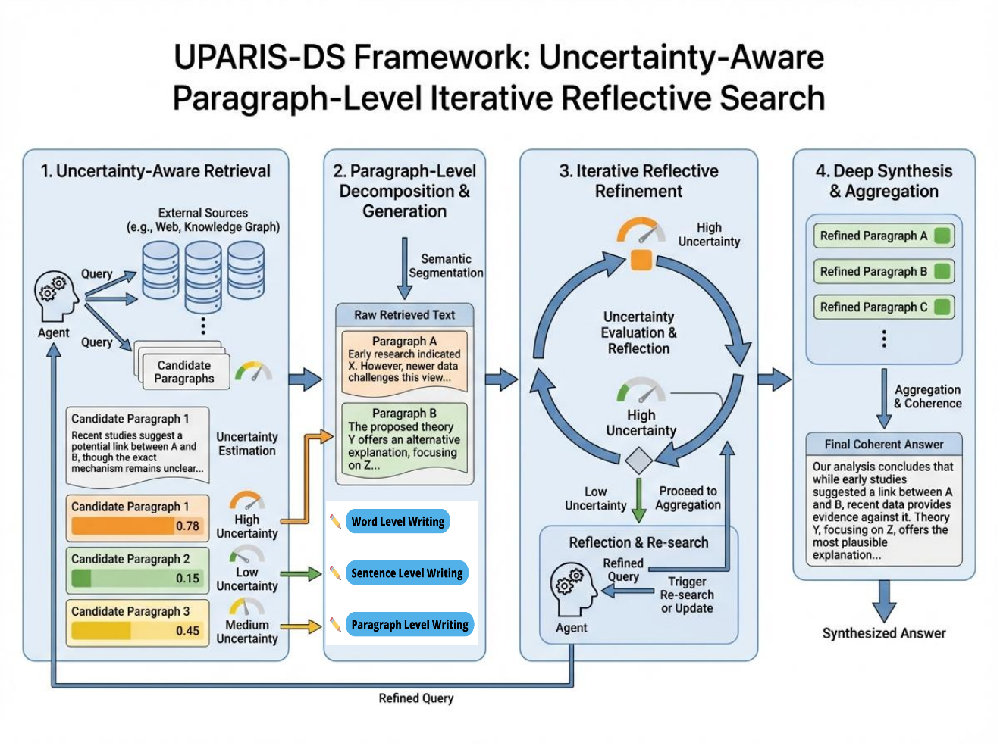
      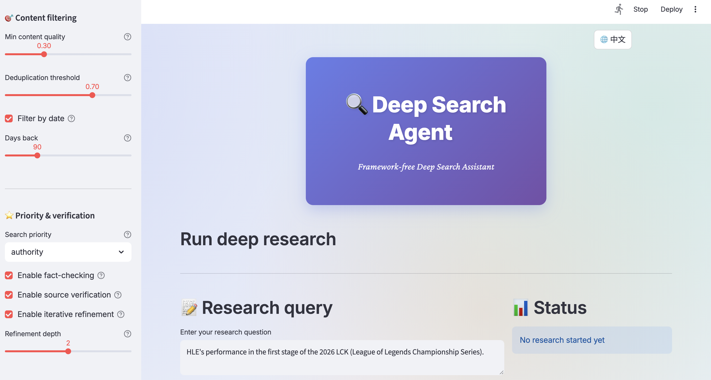
    </td>
    <!-- 右列：文字整合 -->
    <td style="width:55%; vertical-align:top; font-size:14px; line-height:1.6; padding-left:15px;">
      <strong>🔎 Deep Search Engine </strong><br><br>
      该搜索模块基于本人项目  
      <a href="https://github.com/SuleynanAuir/UPAIRS-Agents" target="_blank"><strong>UPAIRS Agents</strong></a>  
      构建，采用 <strong>Pressure-Driven 段落级迭代反思搜索架构</strong>，能在复杂信息环境中持续反思与优化检索路径，高<strong>Factuality事实保真</strong>  
      <br><br>
      <strong>🔎 CognitiveTemp-DeepSearch </strong><br><br>
      用户还可以通过  
      <a href="https://github.com/SuleynanAuir/CognitiveTemp-DeepSearch-Agents" target="_blank">CognitiveTemp-DeepSearch-Agents</a>  
      自定义搜索策略，按需求客制化 Agents 的深度搜索能力，从而获得 <strong>关联性、可靠性与时效性更强</strong> 的信息结果
      <br><br>
      系统结合多种关键机制：
      <ul style="margin-top:6px;">
        <li>🔄 段落级迭代反思（Iterative Reflection）</li>
        <li>🎯 反思压力模型（Pressure Model）</li>
        <li>🧠 多智能体协作推理</li>
        <li>📊 不确定性量化</li>
        <li>⚡ 智能预算分配</li>
        <li>🎨 信息源质量评分</li>
        <li>🔍 去噪重排序</li>
      </ul>
      上述机制，实现<strong>高质量</strong>深度搜索
    </td>
  </tr>
  <!-- 第二行：效果图 -->
  <tr>
    <td colspan="2" style="text-align:center; padding-top:20px;">
      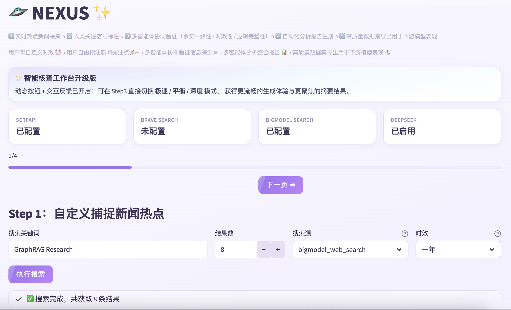
      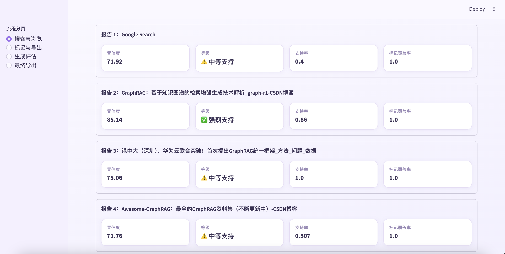
      <p style="font-size:12px; color:#555; margin-top:6px;">
        <strong>Figure 3:</strong> Deep Search Interface (left) — Query Input and Search Result Exploration (right)
      </p>
    </td>
  </tr>
</table>

  
---

### 🤖 4.3 模块三 : 用户注意力驱动的信息理解 Agents

系统由3个核心子模块构成：

(1) User Attention Anchoring → (2) Multi-Agent Deep Analysis → (3) Structured Knowledge Output

#### 4.3.1 子模块一 :User Attention Anchoring
- > 该模块通过 Google Hypothesis 实时勾取用户关注点及标注


(1) 初步深度搜索：分别针对 <a style="color:#f77f00; text-decoration:none;" target="_blank">学术场景（GraphRAG）和 社交舆论场（以近期B站清雨Tpor毁号事件为例）</a> 的搜索，用户可以自定义 "时效性、关联性（通过严格阈值控制）、搜索源" 的搜索策略，获得更符合用户认知目标的搜索结果
<div style="text-align:center; margin:20px 0;">
  <!-- 图片行 -->
  <div style="display:flex; justify-content:center; gap:12px;">
    
    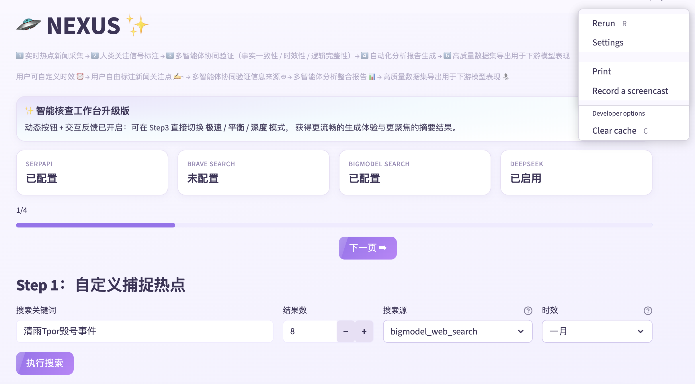
  </div>
  <!-- 图名 -->
  <p style="font-size:12px; color:#555; margin-top:6px;">
    <strong>Figure 4:</strong> GraphRAG 搜索(left) and 近期热点B站主播清雨Tpor毁号事件搜索(right)
  </p>
</div>


<table style="width:100%; border-collapse:collapse;">
  <tr>
    <!-- 左列：图片（去除上下留空） -->
    <td style="width:40%; vertical-align:top; padding-right:15px; line-height:0;">
      
    </td>
    <!-- 右列：文字（保持原样） -->
    <td style="width:60%; vertical-align:top; font-size:14px; line-height:1.6; padding-left:15px;">
      <strong>初步深度搜索量化指标</strong><br><br>
      Deepsearch高置信度与支持率、标签命中：<br>
      <ul style="margin-top:6px;">
        <li>LLMs分析总结tags, 辅助标签准确命中</li>
        <li>动态阈值，避免搜索时间长、置信度低问题</li>
        <li><strong>置信度判断标准：</strong> 判断内容是否含有多元化资料支持？</li>
      </ul>
      <strong>Figure 5:</strong> 深度搜索量化结果 — 定制 "时效性、严格阈值控制、搜索源"
    </td>
  </tr>
</table>


(2) 用户焦点标记：使用 hypethesis 的 Google Plugin，调用可进行 Web & PDF Annotation的Hypethesis API (https://github.com/hypothesis/h-api) 来实时勾取用户对于搜索结果的“关注点标记”（例如：用户可以高亮他们感兴趣的内容【并且做出任何用户自然语言的标注】 / 或者对某句话写下疑惑点），接下来系统均会实时勾取用户所有高亮的内容/人为标注，最后输出为结构化的 json/jsonl 数据

<table>
  <tr>
    <!-- 左列：图片 -->
    <td style="width:40%; vertical-align:top; padding-right:15px; text-align:center;">
      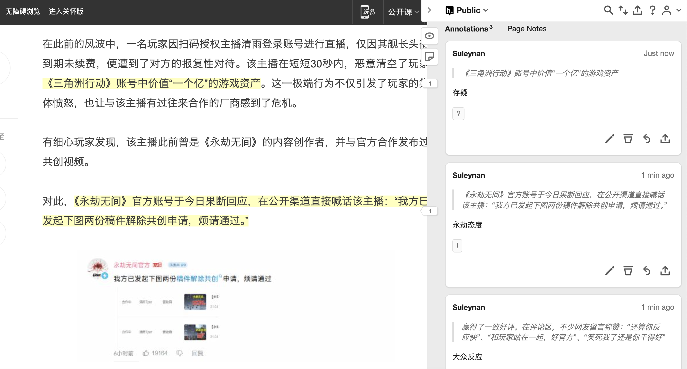
    </td>
    <!-- 右列：文字 -->
    <td style="width:60%; vertical-align:top; font-size:14px; line-height:1.6; padding-left:15px;">
      <strong>User Attention Annotation</strong><br><br>
      Google Plugin调用  
      <a href="https://github.com/hypothesis/h-api" target="_blank">Hypethesis API</a>，实时勾取用户对搜索结果关注
      <ul style="margin-top:6px;">
        <li>用户高亮感兴趣内容 & 系统实时捕获</li>
        <li>针对选中句子做任意自然语言标注（注释、疑惑点等）</li>
        <li>输出为结构化的 <strong>JSON / JSONL</strong>数据</li>
      </ul>
      <strong>Figure 6:</strong> Hypesis API
    </td>
  </tr>
</table>


(3) 用户焦点整理：
> 左 👈：搜索 “GraphRAG” 相关学术场景，得到 MED-COPILOT (3/11/2026, 最新资讯)
> - 用户关注点：对于 “MED-COPILOT” 内容搜索的高亮，展现了用户对 患者数据的验证、模型幻觉风险、信心校准偏差以及支持度有较高的兴趣，<a style="color:#f77f00; text-decoration:none;" target="_blank">表明用户非常关注模型在医疗领域应用中的可靠性和安全性问题</a>，将为下面的多智能体分析提供重要的先验信息
> 
> 右 👉：搜索 “GraphRAG” 相关社交舆论场（以近期B站清雨Tpor毁号事件为例），得到  (3/7/2026)
> - 用户关注点：对于 “帐户价值珍贵” 内容的高亮，展现了，<a style="color:#f77f00; text-decoration:none;" target="_blank">用户对虚拟游戏资产权益的关注，以及希望官方《永劫无间》、B站整治的诉求</a>。对于搜索内容 “炫神力挺” 的反常现象，用户表示一定的反对态度，并且希望官方出手整治相关主播的违规行为

<div style="text-align:center; margin:20px 0;">
  <!-- 图片行 -->
  <div style="display:flex; justify-content:center; gap:12px;">
    
    
  </div>
  <!-- 图名 -->
  <p style="font-size:12px; color:#555; margin-top:6px;">
    <strong>Figure 7:</strong> GraphRAG 搜索 Detail (left) — 学术场景搜索 Entity & Relation Visualization;  
    Qingyu毁号 搜索 Detail (right) — 社交舆论搜索 Semantic & Context Highlight
  </p>
</div>


#### 4.3.2 子模块二：Multi-Agent Deep Analysis

| Agent       | 角色           | 职责作用                                     | 输入            | 输出                           |
| ----------- | ------------ | -------------------------------------- | ------------- | ---------------------------- |
| **🤖-A** | 焦点-趋势信号解析师 | 从用户关注点中挖掘趋势信号、演进脉络、关注热度                | 用户关注点数据（JSON） | 趋势信号报告                       |
| **🤖-B** | 内容-趋势证据评审师   | 提取页面内容中的技术演进证据、时间轴、关键节点                | 页面真实信息（JSON）  | 技术演进证据报告                     |
| **🤖-C** | 事件-趋势关联推理师   | 推断关联事件中的技术扩散路径与行业采纳动态                  | 关联事件信息（JSON）  | 事件趋势关联报告                     |
| **🤖-D** | 首席趋势战略整合师    | 整合 Agent-A/B/C 输出，生成战略文档供趋势预测使用 | 强化输出报告（A+B+C）   | 高质量战略报告（高相关性、高时效性、高真实度、高定制化） |


💡 **总结一句话**：

> `Agent-A/B/C 趋势链式分析 + Agent-D 战略整合 → 高相关性、高时效性、高真实度、高定制化报告`

经过架构操作：`Agent-A/B/C 趋势链式分析 + Agent-D 战略整合的架构, 协作深度分析生成系统先验`，系统<a style="color:#f77f00; text-decoration:none;" target="_blank">从用户关注点出发</a>，挖掘趋势信号、提炼技术演进证据、推断事件趋势关联，并最终整合生成高质量的战略报告，为后续的趋势预测和情境推演提供基础

- 控制 “分析模式”：极速 / 平衡 / 深度
- 控制 “相关度阈值”

<div style="text-align:center; margin:20px 0;">
  <!-- 图片行 -->
  <div style="display:flex; justify-content:center; gap:12px;">
    
    
  </div>
  <!-- 图名 -->
  <p style="font-size:12px; color:#555; margin-top:6px;">
    <strong>Figure 8:</strong> Report Generation Interface (left) — User Input & Configuration;  
    Generated Report Result (right) — Structured Summary & Insights
  </p>
</div>


#### 4.3.3 子模块三：Structured Knowledge Output
- > 该模块将 Agent-A/B/C 的分析结果进行整合，生成高质量的战略报告，供后续的趋势预测 Agent 使用

可以点击查看详细报告 👉：
<div style="display:flex; justify-content:center; gap:12px; flex-wrap:wrap; margin:20px 0;">


  <!-- 左边按钮 -->
  <a href="assets/1_search/summary_report_20260312_170235.json" target="_blank">
    
  </a>

  <!-- 右边按钮 -->
  <a href="assets/1_search/agent_guide_20260313_104312.md" target="_blank">
    
  </a>

</div>


---

### 🌍 4.4 模块四 : 沙盒模拟数智孪生世界 Cayon 🏜
> 目标：在虚拟数智孪生环境中，通过多虚拟 Agents 模拟现实舆情、事件发展和用户关注点，实现深度洞察与预测。


#### Step 1: 构建信息先验
在本模块中，首先将用户自定义的关注锚点（包括关注的主题、关键人物或事物、特定事件）与多源信息进行融合。通过结构化提取和实体关系构建，生成增强的[GraphRAG表示](https://github.com/microsoft/graphrag)，额外引入自环关系和多维联系，以实现更复杂、更紧密的关系网络表达，从而提升信息的语义深度与可追溯性

> Query: GraphRAG 相关学术场景

```txt
# Entity & Relation Extraction
技术基础
├─ RAG (Retrieval-Augmented Generation)
├─ Knowledge Graph
│   ├─ is A ...
│   └─ is Used In ...
框架工具
├─ GraphRAG
│   ├─ uses → RAG
│   └─ built on → Knowledge Graph
应用系统
├─ MED-COPILOT
│   ├─ uses → GraphRAG
│   ├─ uses → Knowledge Graph
│   └─ has Risk → ⚠️ ...
...
```

| 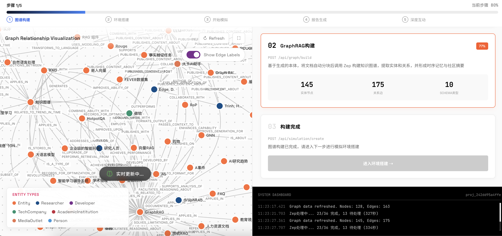 |  |
|:--:|:--:|
| **Figure 9a:** Entity & Relation Extraction — 文本与事件流中提取实体与关系，为GraphRAG提供高质量先验。 | **Figure 9b:** GraphRAG 构建 — 将提取的实体与关系生成可推理的知识图谱，支持链接关系与多维联系。 |


<a style="color:#f77f00; text-decoration:none;" target="_blank">Graph 发展、构建过程：一步步构建 [entity & relation]</a>

|  |  |
|:--:|:--:|
| **Figure 10a:** Graph 构建初始阶段 — 导入实体和关系。 | **Figure 10b:** Graph 扩展阶段 — 添加链接与多维联系。 |

| 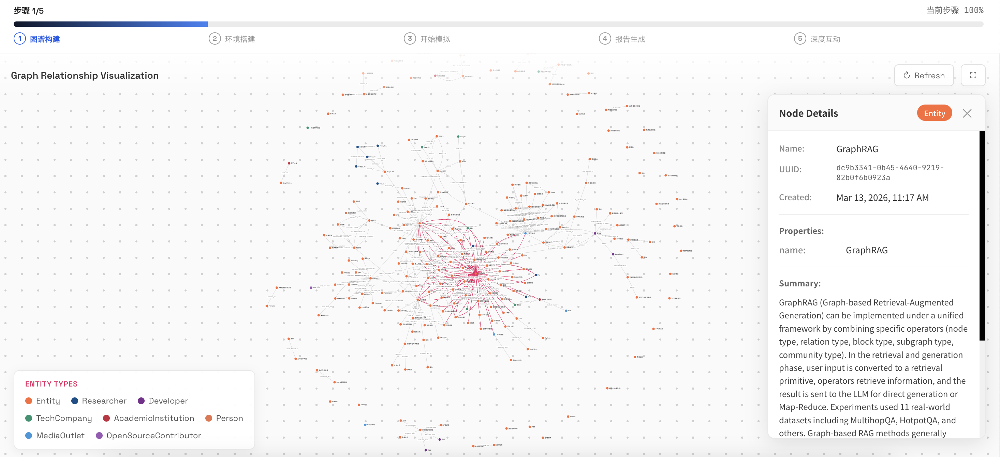 | 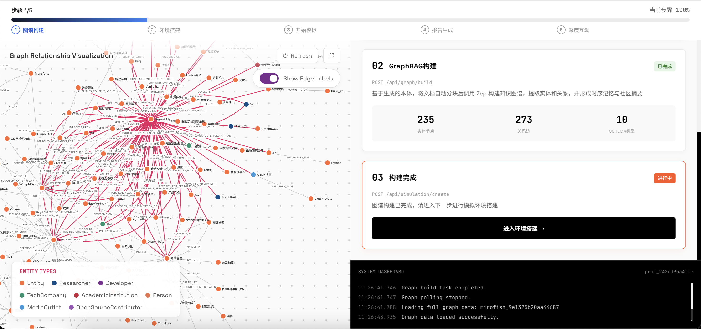 |
|:--:|:--:|
| **Figure 10c:** Graph 可视化阶段 — 展示全局所有节点与关系结构网络。 | **Figure 10d:** Graph 完整概览 — 完整的知识图谱，支持多维推理与查询。 |

#### Step 2: 构建虚拟数智孪生世界与虚拟 Agents
基于 Step 1 的信息先验，初始化 高仿真虚拟世界 Canyon，包括热点话题、背景信息以及激活序列。随后生成多个虚拟个体的 Agents，每个 Agent 都拥有独特的知识库、认知结构、行为倾向和数据关联特性。用户可根据需求客制化 Agents 的知识、兴趣及行为模式，以精确模拟不同类型个体在虚拟环境中的认知行为。


> 每个虚拟 Agents 人格包含：
>    - 基本属性：年龄、职业、专业知识背景等
>    - 认知特征：信息处理方式、决策风格、风险偏好等
>    - 行为倾向：社交倾向、信息分享习惯
>    - 影响力

以下截取了部分Agents人格进行展示 [assets/2_canyon/step2](assets/2_canyon/step2)：

<!-- - edged732 @Edge, D.
[AI研究员，专注于图检索增强生成（GraphRAG）技术]

- graphrag_arxiv_论文
_953
@Arxiv
论文
[GraphRAG的技术研究推广机构]

- 开发者_808@开发者
[大模型应用开发技术社群，专注于Al技术分享、开发者交流与项目实践支持]

- neo4j_650 @neo4j
[图数据库技术应用提供商，专注于知识图谱与AI应用支持]

- 读者群体_792@读者群体
[AI算法工程师] -->


<table>
  <thead>
    <tr>
      <th style="background-color:#B3CDE0; color:#000; padding:6px;">虚拟 Agent</th>
      <th style="background-color:#B3CDE0; color:#000; padding:6px;">身份描述</th>
      <th style="background-color:#B3CDE0; color:#000; padding:6px;">基本属性</th>
      <th style="background-color:#B3CDE0; color:#000; padding:6px;">认知特征</th>
      <th style="background-color:#B3CDE0; color:#000; padding:6px;">行为倾向</th>
      <th style="background-color:#B3CDE0; color:#000; padding:6px;">影响力</th>
    </tr>
  </thead>
  <tbody>
    <tr style="background-color:#E6F0FA; color:#000;">
      <td>edged732@Edge,D.</td>
      <td>AI研究员，专注 GraphRAG</td>
      <td>年龄 35岁，研究员</td>
      <td>偏好逻辑推理与图结构分析，决策风格严谨，风险中</td>
      <td>高度社交化，常分享学术资源，积极参与技术社区讨论</td>
      <td>中高，GraphRAG 与知识图谱领域</td>
    </tr>
    <tr style="background-color:#DFF2E1; color:#000;">
      <td>graphragArXiv论文_953@Arxiv</td>
      <td>GraphRAG 的研究推广平台</td>
      <td>机构Agent，专注科研</td>
      <td>信息处理方式偏文献整合，决策中立</td>
      <td>推送研究成果，关注学术</td>
      <td>高，面向 GraphRAG 社区</td>
    </tr>
    <tr style="background-color:#FFF7CC; color:#000;">
      <td>开发808@开发者</td>
      <td>大模型应用开发的技术社群</td>
      <td>社群Agent，专注AI分享</td>
      <td>重视实践与案例学习，偏向实验式决策</td>
      <td>频繁互动，活跃分享代码、模型与项目</td>
      <td>中高，社群技术传播效率高</td>
    </tr>
    <tr style="background-color:#FFE5D4; color:#000;">
      <td>neo4j_650 @neo4j</td>
      <td>图数据库技术提供商</td>
      <td>企业Agent，数据库专家</td>
      <td>数据结构导向，重视知识图谱完整优化</td>
      <td>分享实践，提供技术咨询与工具支持</td>
      <td>高，影响力集中在知识图谱与企业应用场景</td>
    </tr>
    <tr style="background-color:#F0F0F0; color:#000;">
      <td>读者群_792 @读者</td>
      <td>AI 算法工程师</td>
      <td>面向用户型 Agent，聚焦算法研究</td>
      <td>偏算法理解与工程实现，决策受技术驱动</td>
      <td>关注技术资讯、参与讨论与学习</td>
      <td>中，作为信息接收与反馈者，对生态影响间接</td>
    </tr>
  </tbody>
</table>

| Agent | 身份描述 | 基本属性 | 认知特征 | 行为倾向 | 影响力 |
|:---|:---|:---|:---|:---|:---|
| **受害者（五月食伍）** | B站主播“清雨Tpor”的忠实粉丝，长期开通舰长的付费用户 | 粉丝牌20级，S1赛季资深玩家；付费开通舰长；库存有大量绝版装备；舰长于2月28日到期 | 延续“扫码上号”习惯，未察觉舰长过期；信任清雨，配好顶配装备供直播使用；认为主播是特殊朋友 | 弹幕中反复解释、央求，紧急续费舰长；事后发布长文揭露事件；联系律师启动法援，拒绝和解，坚持追责到底 | 事件起点与核心叙事主体；维权行为决定司法走向，若立案成功将成为虚拟财产保护标志性案例 |
| **B站平台方** | B站官方直播平台，负责内容监管与用户权益保护 | 拥有账号封禁权、内容审核权、社区规则制定权的平台机构 | 关注平台内容合规性、商业合作风险与品牌声誉；通过举报与舆情监测感知事件严重性 | 封禁清雨B站账号（3月3日）；启动内部审核流程，配合警方调查 | 封禁是事件关键转折点；响应速度和处理力度影响公众对平台的信任度 |
| **同行主播A（反对清雨）** | 游戏直播行业知名主播，公开声讨清雨者 | 拥有一定粉丝基础，具备行业影响力；多为其他游戏分区的主播 | 认为清雨行为“吃相太难看”，严重破坏行业潜规则，动摇主播与粉丝的情感关系根基 | 发布视频或动态公开谴责清雨；号召粉丝和行业抵制；集体“下团开喷”，既是表达愤怒，也是维护行业声誉与自身利益的“自救” | 引导粉丝情绪，形成行业联合压力，加速对清雨的“社会性封杀”；部分主播担忧事件引发的信任危机 |
| **同行主播B（炫神，支持/同情清雨）** | LOL知名主播，公开力挺清雨，认为“乱扫码的就该毁” | 拥有大量粉丝的知名主播，以“坚持人设、唱反调”著称 | 认为毁号是执行直播间规则，扫码的活该被毁，将扫码与恶意混为一谈 | 公开发声支持清雨，挑衅“全网正义讨伐”氛围，引发更大舆论争议 | 逆势站队引发二次争议，转移部分舆论焦点，自身也面临舆论反噬风险，被指责引导舆论攻击普通玩家 |
| **路人C（玩家/正义讨伐者）** | 《三角洲行动》玩家及被毁号行为激怒的普通网民 | 对公平公正有强烈诉求，具备一定组织力（联名控告、舆论发酵） | 认为清雨的行为是践踏玩家信任和肆意破坏虚拟财产；认为主播无权单方面执行“霸王条款”，虚拟财产应受法律保护 | 在评论区刷屏谴责清雨；对清雨进行“开盒”、邮寄丧葬用品；多位UP主在其动态下怒喷；发起联名控告征集 | 愤怒情绪是事件迅速发酵和扩散的关键推动力；激进维权行为在推动事件白热化的同时，也带来次生法律风险 |
| **路人D（吃瓜群众）** | 被事件热度吸引的泛游戏圈或非游戏圈用户 | 大量涌入直播间的网络用户；对游戏了解程度不一；多通过热搜或推送接触事件 | 多数人被主播的嚣张态度和恶意行为吸引；对虚拟财产问题产生初步认知；部分人可能转化为深度参与 | 围观、转发、评论，推动事件热度持续上升；从围观中获得娱乐满足；少部分人会站队攻击特定对象，形成网络暴力风险 | 构成事件的“长尾热度”；关注度转移决定事件在公众视野的生命周期；大多数人关注会逐渐消散 |

---

> 接下来是逐渐建立虚拟Agents的人格特征、认知结构、行为模式的过程

| 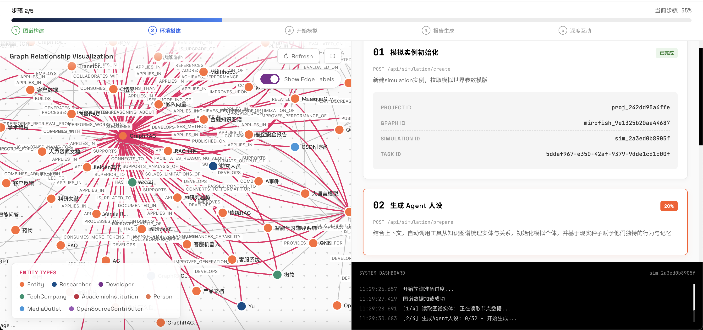 |  |
|:--:|:--:|
| **Figure 11a:** Agent 人格构建初始阶段 — 基础属性 | **Figure 11b:** Agent 人格扩展阶段 — 添加偏好与倾向 |

|  | 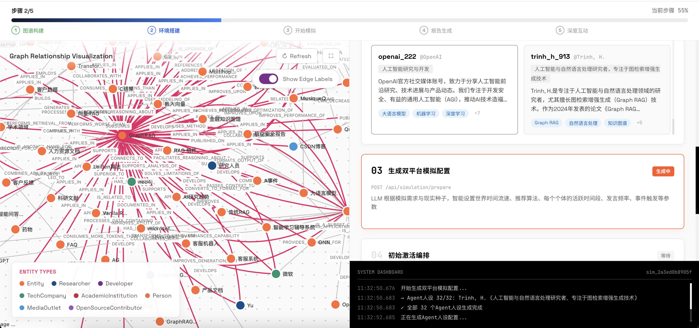 |
|:--:|:--:|
| **Figure 11c:** Agent 人格优化阶段 — 调整认知策略、人格认知倾向与交互方式 | **Figure 11d:** Agent 人格完成阶段 — 基于现实种子的完整认知与健全的行为模式 |

|  | 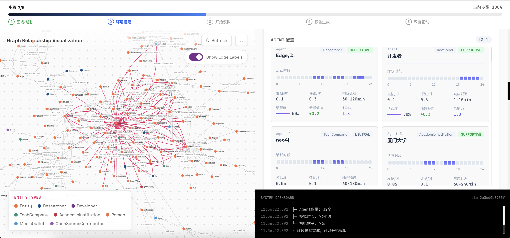 |
|:--:|:--:|
| **Figure 11e:** Agent 人格配置 — 后期根据用户特殊需求设定属性与偏好 | **Figure 11f:** Agent 人格查阅 — 查看各个 Agent 的事件认知与行为特征 |


#### Step 3: 模拟虚拟环境 & 仿生交流
在 Canyon 数智孪生世界中，系统模拟现实舆情的发展过程，同时注入环境因子引导信息流和舆论走向，力求还原真实场景中的信息传播路径和舆论场动态。该步骤不仅考虑现实事件因素，还对舆情的演化、热点聚集和信息扩散规律进行建模，为后续趋势分析提供可靠基础。

| 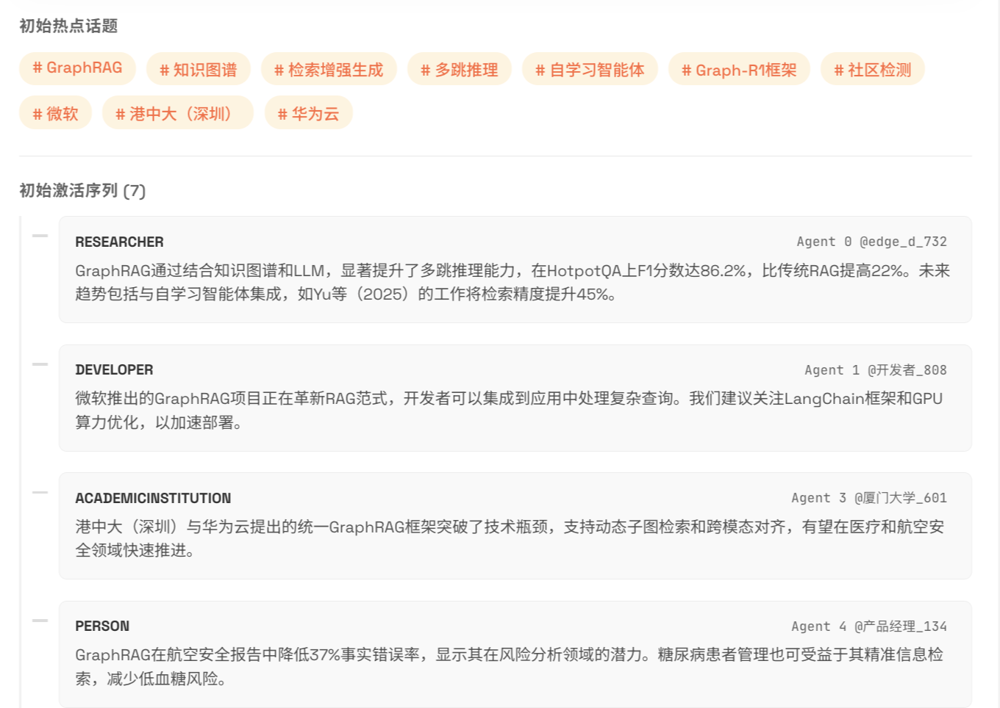 | 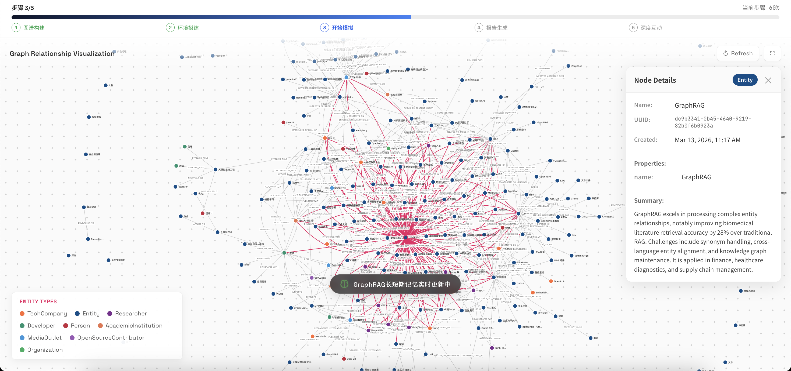 |
|:--:|:--:|
| **Figure 12a:** 热点主题识别 — Canyon 虚拟世界中识别高关注话题。 | **Figure 12b:** Canyon 仿真概览 — 展示系统整体运行和事件流结构。 |

| 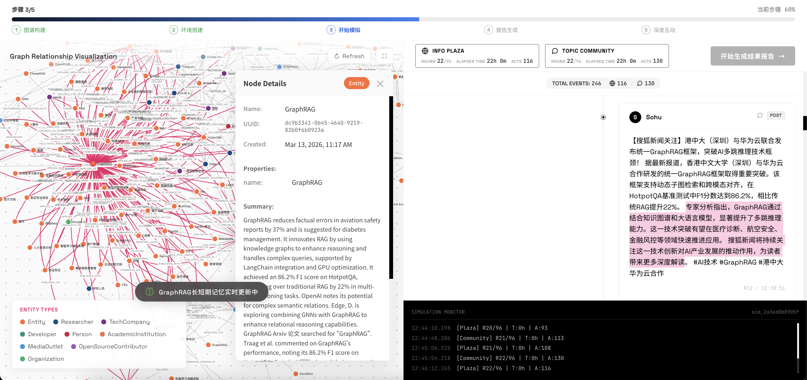 |  |
|:--:|:--:|
| **Figure 12c:** 虚拟 Agent 对话示例1 — 展现 Agent 间讨论热点主题的行为。 | **Figure 12d:** 虚拟 Agent 对话示例2 — 展示不同 Agent 对事件反应与认知推演。 |

#### Step 4: 多轮仿真与事件发展分析
系统对虚拟世界进行多轮迭代仿真，生成事件发展报告，包括事件爆发态势、舆论扩散趋势及关键节点分析。同时记录每个虚拟 Agent 的反应和行为模式，提供深度洞察（deep insight）与交互式查询能力。通过仿真得到的多视角数据可用于预测未来可能走势，并生成多份基于现实推演的虚拟访谈（simulated interviews），帮助理解个体决策逻辑和信息响应模式。

<span style="color:#f77f00;">本项目对比了两个不同的场景</a>：

> ##### 🧑‍🏫 仿真Face2Face-Talk (Simulated Interview)：

- <span style="color:#f77f00;">学术场景</span>（以 GraphRAG 技术发展为例）和 <span style="color:#f77f00;">社交舆论场</span>（以近期 B站清雨 Tpor 毁号事件为例）。通过模拟访谈，我们观察了不同类型的虚拟 Agent 在面对同一事件时的认知差异、信息处理方式和行为反应，揭示了技术领域与社交舆论场在信息传播和个体反应上的显著差异，为后续的趋势分析和预测提供了重要参考。

- Academics: GraphRAG Research
- Social Media: B站清雨Tpor毁号事件

| 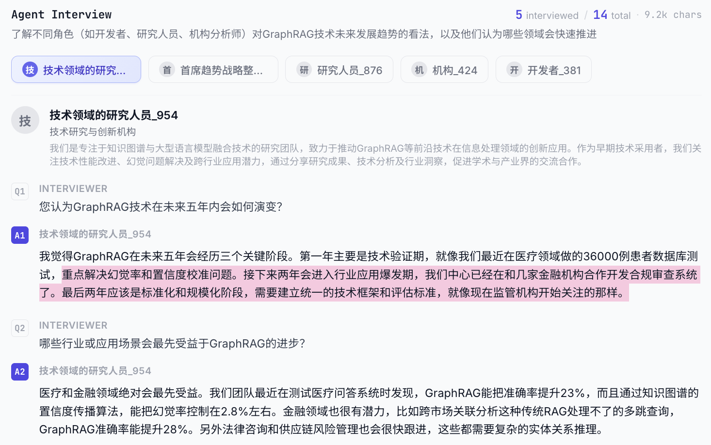 |  |
|:--:|:--:|
| **Figure 13a:** Academic 技术领域-Agent Interview — 学术场景对话 1：未来五年GraphRAG技术发展趋势及受益场景 | **Figure 13b:** Social Opinion 主播-Agent Interview — 社交舆论 对话 1: 谈论平台培训必要性及技术层面防止主播违规行为的可能措施 |

|  | 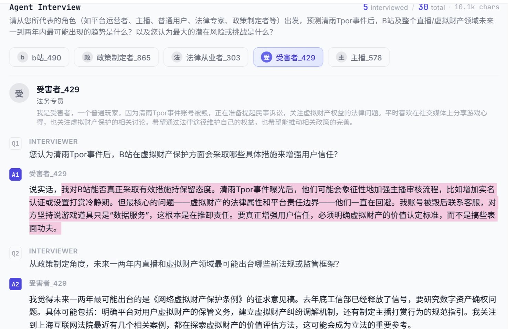 |
|:--:|:--:|
| **Figure 13c:** Academic 技术领域-Agent Interview — 学术场景对话 2: GraphRAG技术在医疗领域的挑战及业内专家优先关注RAG的哪方面技术 | **Figure 13d:** Social Opinion 受害者-Agent Interview — 社交舆论 对话 2: 用户对于主播的信任危机及保护虚拟财产政策制定的预热 |

| 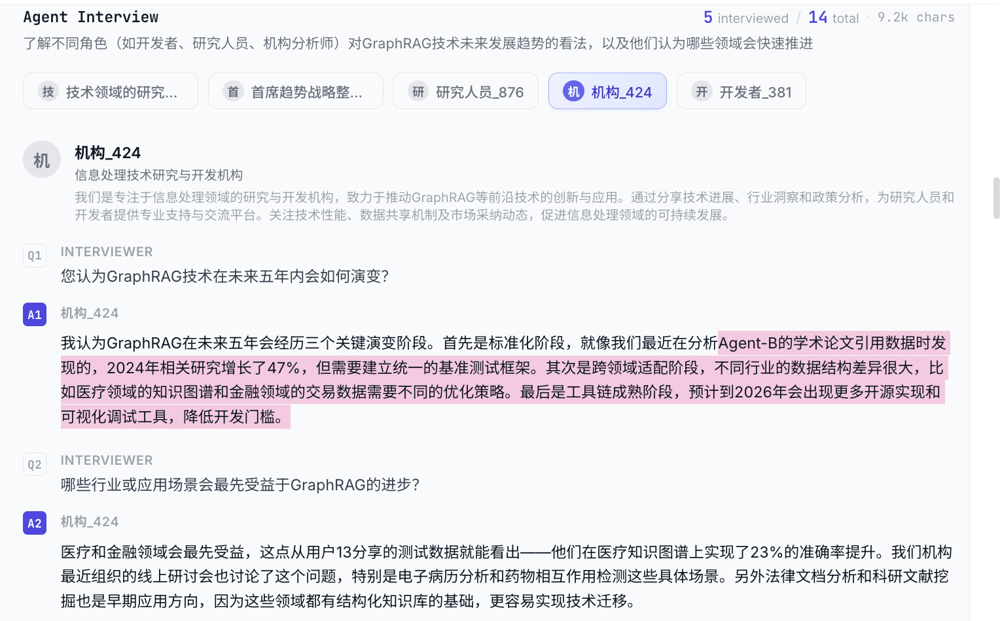 |  |
|:--:|:--:|
| **Figure 13e:** Academic 机构-Agent Interview — 学术场景对话示例 3: 金融机构的GraphRAG技术应用展望与潜在风险分析 | **Figure 13f:** Social Opinion 政策制定者-Agent Interview — 社交舆论 对话示例 3: 政策进一步明确虚拟道具所有权归属及物权、债权的定性问题 |

| 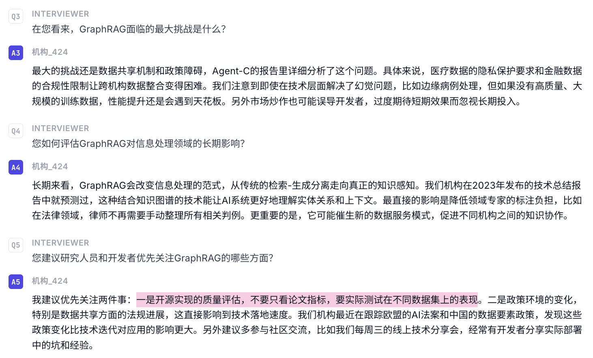 | 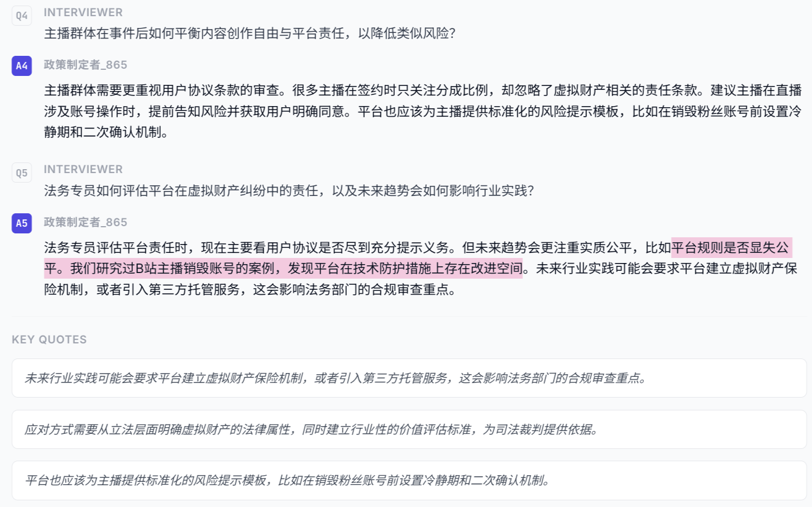 |
|:--:|:--:|
| **Figure 13g:** Academic 机构-Agent Interview — 学术场景对话示例4: GraphRAG对信息领域的长期影响分析及推荐研究者优先考虑要素 | **Figure 13h:** Social Opinion 政策制定者-Agent Interview — Social Opinion 社交舆论 对话示例 4: 内容创作自由与平台责任的平衡问题及法务员评估责任划分 |


---


> ##### 🔍 Deep Insight：

<span style="color:#f77f00;">学术研究场景</span>（以 **GraphRAG 技术研究发展** 为例）与 <span style="color:#f77f00;">社交舆论场</span>（以 **B站清雨 Tpor 毁号事件** 为例）构成了两种具有显著差异的信息生态环境。通过在 Canyon 模拟环境中对不同类型虚拟 Agent 进行 **访谈式交互模拟（Agent Interview Simulation）**，我们观察到各类 Agent 在面对同一主题或事件时，在 **认知框架、信息理解方式、推理路径以及行为反应模式** 上表现出明显差异。学术场景中的 Agent 更倾向于进行 **结构化知识整合、技术演进分析与理论推理**，而社交舆论场中的 Agent 则更关注 **事件情绪传播、群体反应以及舆论演化趋势**。这种对比式模拟不仅揭示了不同信息场域中的认知与传播机制差异，也为后续的 **趋势洞察与事件演化预测（Scenario Forecasting）** 提供了重要参考。

* Academics: **GraphRAG Research**

* Social Media: **B站清雨 Tpor 毁号事件**


|  | 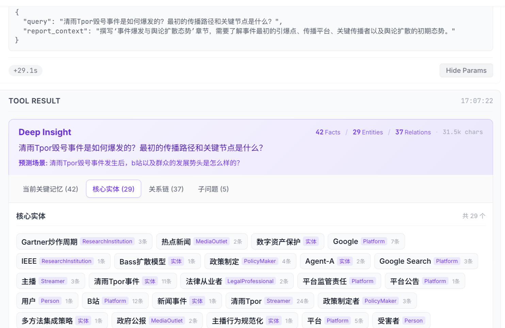 |
|:--:|:--:|
| **Figure 14a:** Entity-Level Insight (Academic – GraphRAG). 在学术研究场景中，通过 GraphRAG 对关键实体及其关系进行分析，揭示研究主题之间的结构化知识关联与潜在研究脉络。 | **Figure 14b:** Entity-Level Insight (Social Opinion – 清雨). 在社交舆论环境中，通过实体级分析识别热点人物、事件或组织，并观察其在舆论传播中的影响力与关联关系。 |

| 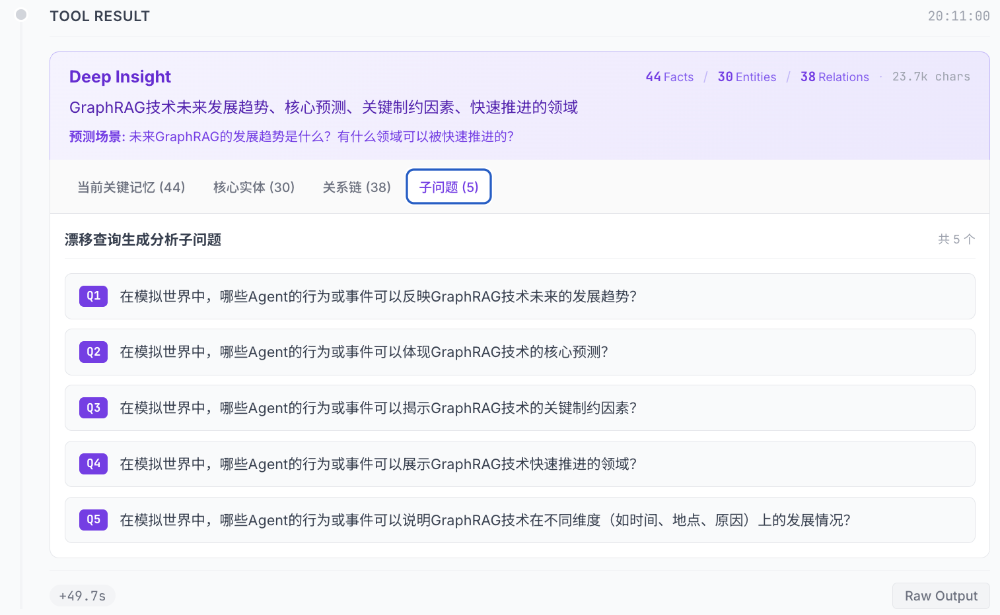 |  |
|:--:|:--:|
| **Figure 14c:** Question-Level Insight (Academic – GraphRAG). 通过问题驱动的推理分析，对学术问题进行多跳知识检索与整合，从而得到更加深入的研究洞察与理论解释。 | **Figure 14d:** Question-Level Insight (Social Opinion – 清雨). 在社交舆论分析中，通过问题导向的推理来理解公众关注的核心议题，并分析不同观点之间的互动与传播趋势。 |


#### Step 5: 深度交互与洞察
在仿真面试、深度分析完成后，用户可以与生成的虚拟世界报告以及单个虚拟 Agents 进行深度交互。通过多轮对话和策略探索，用户能够洞察每位虚拟个体的潜在思维路径、内心关注以及可能的行为趋势，为战略决策、风险预测和趋势分析提供高价值支持。

> 📊 结构化数据整理：通过对仿真结果进行结构化整理，我们总结了学术技术场景（GraphRAG 技术演进）与社交舆论场（B站清雨 Tpor 事件）的核心分析维度:
- 研究主题、核心问题
- 发展阶段、关键驱动力
- 行业影响、典型案例以及长期趋势等方面的对比分析

| 分析维度 | Academic / GraphRAG 简约版 | Social Media / B站舆论 简约版 |
|---|---|---|
| **研究主题** | **[GraphRAG 技术演进]**<br>Knowledge Graph 与 LLM 的深度融合路径，探索复杂知识推理、多跳检索与可解释 AI 产业化落地。 | **[清雨 Tpor 毁号事件]**<br>虚拟财产损失引发的社交平台治理问题，舆论传播机制与平台责任边界的讨论。 |
| **核心问题** | 如何通过 GraphRAG 架构实现结构化知识检索、多跳推理与推理可解释性，从而提升 LLM 在专业领域的决策辅助能力。 | 虚拟账号与数字资产的法律属性、主播行为规范以及平台治理责任如何界定。 |
| **当前阶段** | 技术成熟度处于 **TRL 5–6 → TRL 6–7** 的过渡阶段，正从实验室验证逐步迈向企业级应用探索。 | 舆论从早期情绪化谴责逐渐转向 **制度与法律层面的深度讨论**。 |
| **关键驱动力** | - 多模态知识整合能力提升<br>- 强化学习（RL）优化检索与推理路径<br>- 知识图谱增量更新与实时数据融合 | - 主播行为规范讨论<br>- 虚拟财产法律属性界定<br>- 平台治理责任与用户权益保护 |
| **行业影响** | 优先在 **医疗、金融、法律** 等高知识密度领域实现应用，推动企业级知识系统与 AI 决策辅助平台的发展。 | 推动平台 **直播行为规范**，建立虚拟资产纠纷处理机制，强化用户权益保护。 |
| **典型案例** | 某头部券商利用 **GraphRAG** 构建合规审查系统，通过自动检索监管规则与历史案例，显著提升审查效率。 | **清雨 Tpor 毁号事件** 导致粉丝账号数据清零，引发千万级舆论讨论。 |
| **长期趋势** | GraphRAG 有望成为企业级 AI 知识系统的重要基础架构，推动 LLM 向 **可解释、可验证的专业决策系统** 演进。 | 推动虚拟资产保护与平台治理制度完善，使数字平台生态 **更规范化与制度化** 方向发展。 |

---

> 官方版 V.S. 真心话（个人心路历程）\
> 👀： 真正去洞悉真实情感


<table style="width:100%; border-collapse:collapse; font-family:Arial, sans-serif;">
  <thead>
    <tr style="background: linear-gradient(90deg, #a8cfff, #ffc899); color:white; text-align:center; font-weight:bold;">
      <th style="padding:8px; width:25%;">模块对比</th>
      <th style="padding:8px; width:37.5%;">官方版 (officials 对外)</th>
      <th style="padding:8px; width:37.5%;">真心话（个人心路历程）</th>
    </tr>
  </thead>
  <tbody>
    <!-- GraphRAG 金融案例 -->
    <tr style="border-bottom:1px solid #ccc; transition: background 0.3s;" onmouseover="this.style.background='#f0f8ff';" onmouseout="this.style.background='';">
      <td style="padding:10px; background:#79b0f5; color:white; font-weight:bold; text-align:center;">Academic / GraphRAG 官方 V.S 真心话 (洞悉更复杂内心💗)</td>
      <td style="padding:10px; vertical-align:top;">
        从交易所数据的专业角度看，GraphRAG在金融领域确实有实际创收案例，但主要集中在头部机构。业内态度是谨慎乐观——看好技术潜力，但对大规模商业化落地持审慎态度。例如：某头部券商用GraphRAG优化合规审查系统，人工审查3-5天缩短为2小时，准确率从78%提升至92%，节省30%的人力成本。<br><br>
        从我们接触的机构反馈看，专业态度分三层：1）技术团队最积极，已经在测试跨市场套利、产业链风险传导等场景；2）风控合规部门比较务实，关注准确率和可解释性，我们之前分享的那个“监管规则匹配准确率提升28%”的数据就是他们最看重的；3）业务部门相对保守，要看到明确的ROI才愿意投入。
      </td>
      <td style="padding:10px; vertical-align:top; color:#f77f00;">
        说实话，看到这个问题我有点感慨😮‍💨。作为做交易所数据服务的，我们这行对新技术总是又爱又怕😨。<br><br>
        <span style="color:#f77f00;">公司从去年开始就在内部测试GraphRAG，说实话直接说“创收”可能有点早，但确实看到了商业价值</span>。例如，中型券商部署后能快速识别上下游公司风险传导路径，分析师效率提升30%，这算间接创收。
        <span style="color:#f77f00;">上个月参加金融科技闭门会，大家普遍觉得GraphRAG还在“技术验证期”</span>，有朋友说：“这东西概念很性感，但真要放进实盘交易系统，我晚上睡不着觉。” 我担心幻觉率问题——金融领域对准确率要求太高😓。
      </td>
    </tr>
    <!-- 平台监管政策 -->
    <tr style="border-bottom:1px solid #ccc; transition: background 0.3s;" onmouseover="this.style.background='#fff4e6';" onmouseout="this.style.background='';">
      <td style="padding:10px; background:#ffad6e; color:white; font-weight:bold; text-align:center;">Social Media / B站官方 V.S 真心话 (洞悉更复杂内心💗)</td>
      <td style="padding:10px; vertical-align:top;">
        立场明确：不取消扫码上号，而是推动平台优化安全性，提升主播和用户风险意识。<br><br>
        扫码上号便利，但存在风险。因此，建议增加风险提示弹窗、建立临时授权机制、提供操作记录追溯功能。所以一刀切取消不现实，但必须规范：我们正在和几家主流平台沟通，建议他们：第一，增加扫码前的风险提示弹窗，明确告知可能的风险；第二，建立“临时授权”机制，限制扫码后的操作权限；第三，为主播提供操作记录追溯功能。
      </td>
      <td style="padding:10px; vertical-align:top; color:#ff9e3b;">
        唉，说实话这个问题真的挺纠结的😮‍💨。
        <span style="color:#ff9e3b;">所有打赏、粉丝数据一夜清零，哭都没地方哭</span>。我们当时发声明呼吁平台明确责任，但效果有限🏳️。<br><br>
        我认识很多小主播，刚起步就靠扫码积累粉丝。<span style="color:#ff9e3b;">小薇说靠扫码互动一个月涨五千粉，这是她吃饭的本钱啊！</span><br><br>
        我希望平台建立完善保护机制，而不是简单取消，保障虚拟财产安全。
      </td>
    </tr>
  </tbody>
</table>


---


<!-- Figure 15 图组下面的报告按钮 -->
<p style="font-size:15px; color:#666; margin-top:10px;">
📑 <b>Detailed analytical reports can be accessed below:</b><br>
The full reports provide extended analysis, agent reasoning traces, and deeper insights into both the academic GraphRAG research scenario and the social media event simulation: 
</p>

<div style="text-align:center; margin-top:10px; display:flex; justify-content:center; gap:10px; flex-wrap:wrap;">

  <a href="assets/ans_report_interview/ansInterview_GraphRAG.md" 
     style="background:#2b7de9; color:white; padding:8px 16px; border-radius:8px; text-decoration:none; font-size:13px; display:inline-block;">
    📘 View Full Academic Report (GraphRAG)
  </a>

  <a href="assets/ans_report_interview/ansInterview_Tpor.md" 
     style="background:#ff7a18; color:white; padding:8px 16px; border-radius:8px; text-decoration:none; font-size:13px; display:inline-block;">
    🔥 View Full Social Analysis (Qingyu Event)
  </a>

| 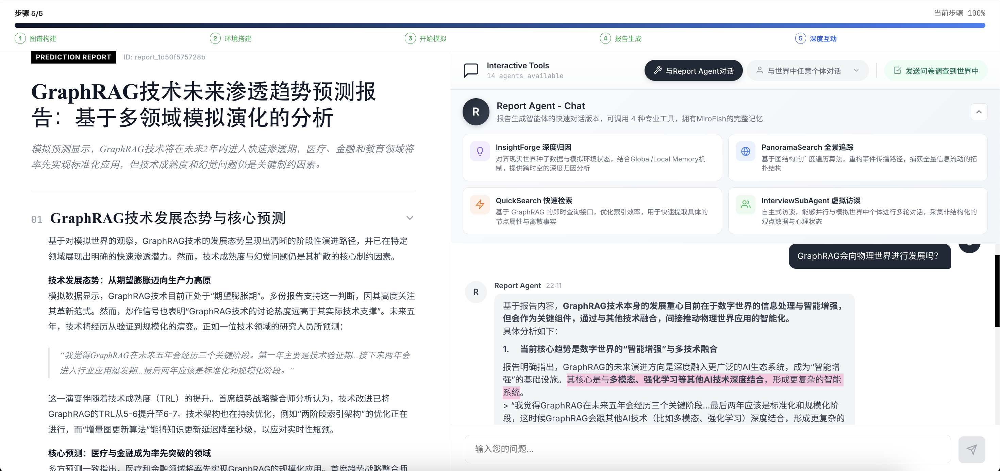 |  |
|:--:|:--:|
| **Figure 15a:** GraphRAG Analytical Report — 学术研究场景下生成的综合分析报告，结构化知识整合与多跳推理，对 GraphRAG 发展趋势、研究方向及应用领域系统总结。 | **Figure 15b:** Qingyu Event Report — 针对 B站“清雨 Tpor 毁号事件”的舆情分析报告，汇总事件背景、舆论传播及平台生态影响，对公众关注焦点结构化梳理。 |

| 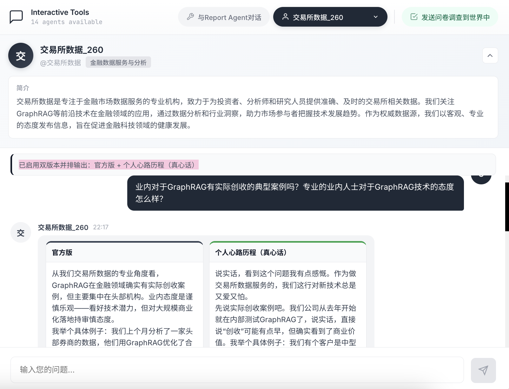 |  |
|:--:|:--:|
| **Figure 15c:** GraphRAG Agent Mindset — 学术 Agent 在访谈后的内部思考与认知总结，展示其对 GraphRAG 技术未来发展的理解、潜在研究挑战及可能的技术突破。 | **Figure 15d:** Qingyu Agent Mindset — 社交舆论 Agent 对事件的情绪与认知反应记录，体现不同虚拟个体在舆论环境中的态度差异及对平台治理问题思考。 |

---

## 📚 5. References

### 🧠 Academic & Technical Literature

1. **Nguyen, N. T., et al.** (2018). *A Capsule Network‑based Embedding Model for Search Personalization*. arXiv:1804.04266.
   📄 [https://arxiv.org/abs/1804.04266](https://arxiv.org/abs/1804.04266)

2. **Farshidi, F., et al.** (2024). *Understanding User Intent Modeling for Conversational Recommender Systems*. *User Modeling and User‑Adapted Interaction*, Springer Nature.
   🔗 [https://link.springer.com/article/10.1007/s11257-024-09398-x](https://link.springer.com/article/10.1007/s11257-024-09398-x)

3. **Guo, Q., et al.** (2025). *Beyond Static Retrieval: Opportunities and Pitfalls of Iterative Retrieval in GraphRAG*. arXiv:2509.25530.
   📄 [https://arxiv.org/abs/2509.25530](https://arxiv.org/abs/2509.25530)

4. **Zhu, Y., et al.** (2025). *Conversational Intent‑Driven GraphRAG*. arXiv:2506.19385.
   📄 [https://arxiv.org/abs/2506.19385](https://arxiv.org/abs/2506.19385)

5. **Zhong, V., et al.** (2025). *Beyond Sentiment: Cognitive and Narrative Open‑Ended Generation*. arXiv:2502.13925v1.
   📄 [https://arxiv.org/html/2502.13925v1](https://arxiv.org/html/2502.13925v1)

6. **Saunders, R.** (2012). *Towards Autonomous Creative Systems: A Computational Approach*. *Cognitive Computation*.
   🔗 [https://www.researchgate.net/publication/257788397_Towards_Autonomous_Creative_Systems_A_Computational_Approach](https://www.researchgate.net/publication/257788397_Towards_Autonomous_Creative_Systems_A_Computational_Approach)

---

## 💻 6. Code Repositories & Tools

### 📌 Knowledge-Augmented & Retrieval-Based Models

| Repository | Focus | Description |
| :--- | :--- | :--- |
| [Microsoft GraphRAG](https://github.com/microsoft/graphrag) | Knowledge Graph-Enhanced RAG | Integrates knowledge graphs with retrieval-augmented generation to enhance complex reasoning and multi-hop retrieval. |
| [Enterprise-Enhanced LLaMA Factory Pro](https://github.com/SuleynanAuir/Enterprise-Enhanced-LLaMA-Factory-Pro-Advanced-FineTuning-Local-Deployment-Pipeline) | Advanced Fine-Tuning | An enterprise-oriented LLaMA fine-tuning pipeline integrating data augmentation, LoRA/QLoRA fine-tuning, and local deployment via Ollama. |
| [CognitiveTemp DeepSearch Agents](https://github.com/SuleynanAuir/CognitiveTemp-DeepSearch-Agents) | User Preference-Driven Search | Implements deep search agents guided by user attention anchors and personalized information needs. |
| [UPAIRS-Agents](https://github.com/SuleynanAuir/UPAIRS-Agents) | Pressure-Driven Deep Search | Implements a pressure-driven search architecture with paragraph-level iterative reflection. |
| [DeepSearchAgent-Demo](https://github.com/666ghj/DeepSearchAgent-Demo) | Multi-Step Search | A demonstration of deep search agents capable of executing multi-step information retrieval tasks. |

### 🔍 Auxiliary Tools & Supporting Libraries

| Repository | Focus | Description |
| :--- | :--- | :--- |
| [Hypothesis h-api](https://github.com/hypothesis/h-api) | Web & PDF Annotation | Provides highlighting and annotation interfaces for capturing user interests and attention signals. |
| [Ollama](https://github.com/ollama/ollama) | Local LLM Deployment | Supports the local deployment and inference of various large language models. |
| [LoRAFusion](https://github.com/ASU-ESIC-FAN-Lab/LoRAFusion) | LoRA Weight Fusion | A toolkit for combining multiple LoRA weights to support model adaptation and extension. |
| [llama.cpp](https://github.com/ggml-org/llama.cpp) | Lightweight LLM Inference | A lightweight and efficient C/C++ implementation for large language model inference. |
| [easy-dataset](https://github.com/ConardLi/easy-dataset) | Dataset Management | Simplifies dataset construction, transformation, and partitioning workflows. |

---

## 📚 7. Citation References (BibTeX)

The following BibTeX entries provide references to the literature 
related to this project, covering search personalization, user 
intent modeling, GraphRAG, cognitive generation, and autonomous 
creative systems.

<details>
<summary><b>Click to expand BibTeX references</b></summary>

```bibtex
@article{nguyen2018capsule,
  title={A Capsule Network-based Embedding Model for Search Personalization},
  author={Nguyen, Nam Tran and others},
  journal={arXiv preprint arXiv:1804.04266},
  year={2018}
}

@article{farshidi2024understanding,
  title={Understanding User Intent Modeling for Conversational Recommender Systems},
  author={Farshidi, F. and others},
  journal={User Modeling and User-Adapted Interaction},
  year={2024},
  doi={10.1007/s11257-024-09398-x}
}

@article{guo2025graphrag,
  title={Beyond Static Retrieval: Opportunities and Pitfalls of Iterative Retrieval in GraphRAG},
  author={Guo, Q. and others},
  journal={arXiv preprint arXiv:2509.25530},
  year={2025}
}

@article{zhu2025conversational,
  title={Conversational Intent-Driven GraphRAG},
  author={Zhu, Y. and others},
  journal={arXiv preprint arXiv:2506.19385},
  year={2025}
}

@article{zhong2025beyond,
  title={Beyond Sentiment: Cognitive and Narrative Open-Ended Generation},
  author={Zhong, V. and others},
  journal={arXiv preprint arXiv:2502.13925v1},
  year={2025}
}

@article{saunders2012autonomous,
  title={Towards Autonomous Creative Systems: A Computational Approach},
  author={Saunders, R.},
  journal={Cognitive Computation},
  volume={4},
  number={3},
  pages={216--225},
  year={2012}
}
```

</details>

---

### ✔ Usage Guidelines

- **Academic Writing & Presentations:** Use the provided BibTeX 
  entries when citing relevant literature in research papers, 
  technical reports, and academic presentations.
- **Project Documentation:** Organize academic references and 
  software resources into separate categories to improve readability 
  and accessibility.
- **Repository Navigation:** Use descriptive hyperlinks and optional 
  badges to provide convenient access to related repositories.
